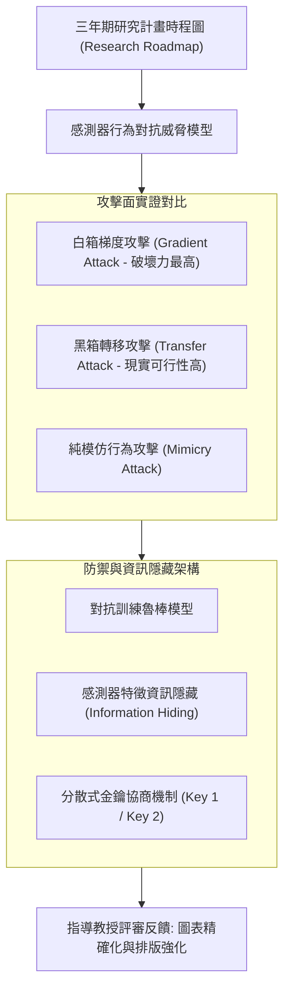

# 📋 全英語三年期研究計畫 Proposal 提案發表與攻防答辯 — 執行摘要

> **活動場次**：網路與系統實驗室 全體定期進度彙報大會 (場次 01)
> **錄音日期**：2026-10-08
> **發言講者**：指導教授 / Proposal報告研究生
> **對應完整逐字稿**：[`20261008-01-全英語三年期研究計畫Proposal提案發表與攻防答辯.full.md`](./20261008-01-全英語三年期研究計畫Proposal提案發表與攻防答辯.full.md)

---

## 📌 核心議題與提案提要

本場次為實驗室三年期重大研究計畫提案（Three-Year Proposal Plan）的全英文正式彩排與答辯。提案聚焦於行動端感測器（Smartphone Sensors）行為模型在對抗性攻擊下的安全評估與主動防禦機制。研究生系統性陳述了研究時程路徑圖（Research Roadmap），並對比了白箱梯度攻擊（Gradient-based Attack）與黑箱轉移攻擊（Transfer Attack）在實務部署中的威脅差異。

指導教授在問答階段針對簡報中的「資訊隱藏（Information Hiding）」與金鑰交換（Key Management）架構頁面進行了嚴格審視，指出投影片排版與數學標記（Key 1 vs Key 2）必須讓跨領域評審一目了然，並針對初步對抗防禦實驗的有效性給予具體修訂指示。

---

## 🏛️ 三年期 Proposal 攻防與研究架構

---

## 🔑 關鍵重點整理 (Key Takeaways)

### 1. 三年提案核心三大子題
- 確立三年研究階段：第一年專注於感測器對抗樣本生成，第二年研發資訊隱藏與特徵保護機制，第三年完成跨裝置分散式落地與效能評測。

### 2. 攻防實證發現：梯度攻擊之主導性
- 初步實驗證明，針對感測器模型，白箱梯度攻擊遠比純模仿學習更具破壞力；防禦機制若僅能抵禦模仿攻擊將不堪一擊，必須建立能抵禦黑箱轉移攻擊的防線。

### 3. 指導教授現場質詢與關鍵攻防反饋
- **投影片排版與數學標記直觀性**：教授特別追問「資訊隱藏與金鑰機制」投影片，告誡同學評審委員時間有限，不可讓觀眾花時間猜測 Key 1 與 Key 2 的定義，要求大幅優化圖表視覺結構。
- **使用者行為漂移（Behavior Drift）核心質疑**：教授直球質詢「如果受害者的操作行為隨時間產生漂移（Behavior Drift），從受害者行為萃取出的動態金鑰（$K_1, K_2$）如何維持一致性？若無法解出單位矩陣，是否會導致合法使用者全面被阻擋？」
- **持續增量學習（Continual Incremental Learning）解決方案**：針對行為改變與資料漂移問題，教授指出不可忽視時間維度，應引入持續增量學習（Continual Incremental Learning）機制，在資源受限環境（如 iPad / 行動端）下篩選歷史關鍵樣本進行週期性動態校準。
- **總計畫與子計畫進度聯防協調**：開場時教授嚴肅提醒總計畫負責人需於每週會前主動跨組對齊子計畫 1、2、3 進度，確保故事脈絡連貫，不得各自獨立作業。

---

## 📊 指導教授攻防質詢與提案修訂方針對照表

| 攻防質詢維度 | 提案研究生簡報原始論點 | 指導教授現場深度質詢與核心點評 | 提案修訂方針與具體行動清單 |
| :--- | :--- | :--- | :--- |
| **使用者行為漂移（Behavior Drift）** | 假設使用者感測器操作行為靜態不變，以此生成 $P$ 與 $P^{-1}$ 金鑰矩陣 | **"You know, in machine learning, people's behavior may drift! How would you defend this problem?"** | 論文第 4 章補充「動態金鑰容錯機制」：允許感測器行為在合理閾值內動態浮動，避免誤殺合法使用者。 |
| **持續增量學習（Continual Learning）** | 未將時間跨度（Temporal Drift）與模型更新納入三年期防禦評估範疇 | 指出使用者在跨週期（Period 1 到 Period 4）行為必然轉變，單次靜態萃取必然失效，要求考慮增量更新架構。 | 引入持續增量學習（Continual Incremental Learning）：在有限算力與記憶體下，挑選最具表徵性之特徵歷史進行動態微調。 |
| **資訊隱藏（Information Hiding）金鑰標記** | 投影片直接羅列 $K_1, K_2$ 與矩陣運算公式，缺少直觀示意圖與物理定義 | 嚴格要求投影片不可讓口試委員與評審花時間猜測變數意義，需立即看懂防禦邏輯。 | 重新繪製架構圖：將第三方（Third Party）消除前後之金鑰協商流程圖解化，明晰實體語意。 |
| **轉移攻擊（Transfer Attack）與梯度攻擊關聯** | 分別介紹梯度攻擊（白箱）與轉移攻擊（黑箱），未明確交代兩者之演進必然性 | 要求梳理故事線：說明為何在成功防禦梯度白箱攻擊後，攻擊者必然轉向利用替代模型（Surrogate Model）進行轉移攻擊。 | 串聯研究敘事：將轉移攻擊定義為「缺乏目標模型權限時之進階梯度攻擊」，凸顯三年期計畫之因果承接。 |
| **跨子計畫聯防與會議前置整合** | 總計畫過去習慣等到大會當天再同步子計畫最新進度與改動 | **「以前總計畫在開會前沒有在一起 meeting 嗎？總計畫要負責做整個故事的起因！」** | 建立會前一週預審機制：總計畫負責人需提前檢核子計畫 1、2、3 產出，確保總計畫 Proposal 故事線整合完備。 |
