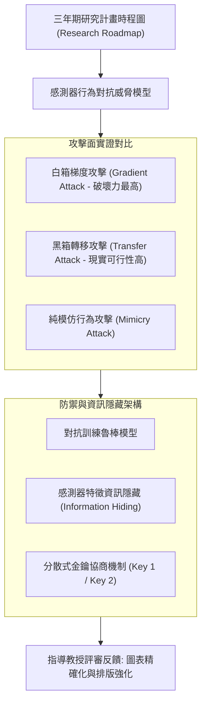

# 📋 全英語三年期研究計畫 Proposal 提案發表與攻防答辯 — 執行摘要

> **活動場次**：網路與系統實驗室 全體定期進度彙報大會 (場次 01)
> **錄音日期**：2026-10-08
> **發言講者**：指導教授 / Proposal報告研究生
> **對應完整逐字稿**：[`20261008-01-全英語三年期研究計畫Proposal提案發表與攻防答辯.full.md`](./20261008-01-全英語三年期研究計畫Proposal提案發表與攻防答辯.full.md)

---

## 📌 核心議題與提案提要

本場次為實驗室三年期重大研究計畫提案（Three-Year Proposal Plan）的全英文正式彩排與答辯。提案聚焦於行動端感測器（Smartphone Sensors）行為模型在對抗性攻擊下的安全評估與主動防禦機制。研究生系統性陳述了研究時程路徑圖（Research Roadmap），並對比了白箱梯度攻擊（Gradient-based Attack）與黑箱轉移攻擊（Transfer Attack）在實務部署中的威脅差異。

指導教授在問答階段針對簡報中的「資訊隱藏（Information Hiding）」與金鑰交換（Key Management）架構頁面進行了嚴格審視，指出投影片排版與數學標記（Key 1 vs Key 2）必須讓跨領域評審一目了然，並針對初步對抗防禦實驗的有效性給予具體修訂指示。

---

## 🏛️ 三年期 Proposal 攻防與研究架構

---

## 🔑 關鍵重點整理 (Key Takeaways)

### 1. 三年提案核心三大子題
- 確立三年研究階段：第一年專注於感測器對抗樣本生成，第二年研發資訊隱藏與特徵保護機制，第三年完成跨裝置分散式落地與效能評測。

### 2. 攻防實證發現：梯度攻擊之主導性
- 初步實驗證明，針對感測器模型，白箱梯度攻擊遠比純模仿學習更具破壞力；防禦機制若僅能抵禦模仿攻擊將不堪一擊，必須建立能抵禦黑箱轉移攻擊的防線。

### 3. 指導教授質詢重點
- 教授特別追問「資訊隱藏與金鑰機制」投影片的直觀性，告誡同學評審委員時間有限，不可讓觀眾花時間猜測 Key 1 與 Key 2 的定義，要求大幅優化圖表視覺結構。
