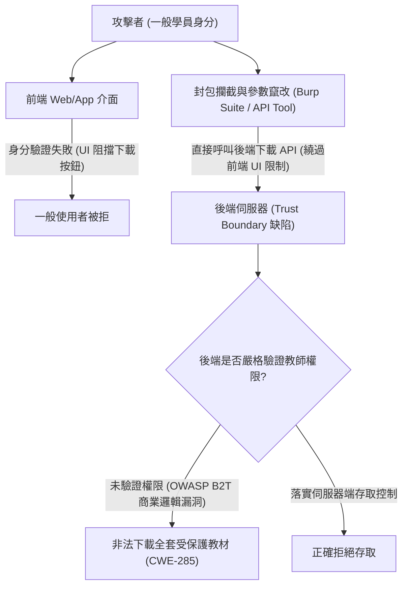

# 📋 PNS 組黑箱測試白箱根因分析與 Web-API 越權繞過研討 — 執行摘要

> **活動場次**：網路與系統實驗室 全體定期進度彙報大會 (場次 02)
> **錄音日期**：2026-10-08
> **發言講者**：PNS組報告研究生 / 指導教授
> **對應完整逐字稿**：[`20261008-02-PNS組黑箱測試白箱根因分析與Web-API越權繞過研討.full.md`](./20261008-02-PNS組黑箱測試白箱根因分析與Web-API越權繞過研討.full.md)

---

## 📌 核心議題與研討提要

本場次由實驗室 PNS 研究小組進行實務資安漏洞與修復架構進度彙報。研究組針對「黑箱測試、白箱根因分析（Root Cause Analysis）與自動化修復（Multi-hunt Repair）」三大核心主軸展開報告。會中展示了某高中數位教科書網站的真實越權下載案例：網站前端在 UI 介面進行身分阻擋（限制僅教師可下載教學資源），但後端 API 卻缺乏相應的授權校驗，攻擊者只需以一般學員登入並竄改 API 參數，即可繞過前端限制非法下載全部受保護教材。

報告進一步引用 OWASP Top 10 以及近期熱門的 Business Logic（B2T）商業邏輯缺陷，深入探討行動 App 與 Server 之間的信任邊界（Trust Boundary）界定，並對應至 CWE 弱點分類與 2026 年最新 CVE 邏輯漏洞案例。

---

## 🏛️ 前端 UI 阻擋 vs 後端 API 越權繞過架構

---

## 🔑 關鍵重點整理 (Key Takeaways)

### 1. 前後端權限不符之根本威脅
- 前端 UI 的任何阻擋（如禁用按鈕、隱藏連結）皆不可視為安全邊界。若後端 API 未落實 RBAC 或 ABAC 權限校驗，攻擊者繞過前端直接發送 HTTP 請求即可達成完全越權。

### 2. 信任邊界（Trust Boundary）模型建構
- 報告定義了六大威脅建模維度：信任邊界劃分、攻擊者能力假定、CWE 弱點對應、攻擊路徑推演、風險等級評估與定性定量分析。

### 3. 未來研究與自動化修復
- PNS 組下一階段將針對此類邏輯漏洞，結合靜態程式碼分析定位根因，並嘗試引入自動化補丁生成工具完成漏洞防禦閉環。

---

## 📊 實務漏洞案例拆解（J2Store PayPal IPN & Nextcloud WebDAV）與三年期規劃

| 漏洞案例／研究階段 | 正常業務流程與安全不變數（Security Invariants） | 攻擊者繞過路徑與 Multi-hunk 根因缺失 | 指導教授對 Threat Model 與研究流程之嚴格指正 |
| :--- | :--- | :--- | :--- |
| **J2Store 電商插件 PayPal 偽造付款繞過** | 使用者選購商品後須跳轉至 PayPal 完成信用卡授權，再由 PayPal IPN 回呼通知商店端點並核驗 erify 憑證與金額 | 匿名攻擊者跳過第三方付款頁面，直接偽造付款成功通知封包打向 J2Store 端點；開發者僅修補單一區塊而遺漏多處分支（Multi-hunk 未修齊） | 教授質疑：「若非看過原始碼知道後端未檢查，黑箱攻擊者如何憑空構造該攻擊鏈？」指出團隊混淆了「已知漏洞重放」與「未知黑箱探索」 |
| **Nextcloud WebDAV 檔案留言與權限越權** | 系統應先驗證使用者（如 Alice）是否具備目標檔案存取權限，通過後方可操作底下留言參數（如 parameter=888） | 攻擊者透過 API 參數傳遞繞過前置身分確認分支，雖然抵達相同結果端點，卻違反中間狀態之安全不變數（Inductive Invariant） | 強調第一年黑箱探索必須交代「如何在龐大狀態空間中透過數百萬次互動訓練找出該漏洞」，而非直接拿現成 CVE 腳本宣稱黑箱發現 |
| **PNS 組三年期模組串接與例行會議制度** | 第一年：完成一階基礎建構、AUG/CFG 增量建構與 SMT 求解器整合；第二年：白箱根因定位；第三年：跨區塊修補 | 報告未放入前次會議 Summary 回顧，且對 10 月 30 日總計畫成果海報（Poster）準備進度掌握不足 | 強制規定每次例會開頭必須宣讀「前次會議決議 Summary」與「下次會議前三位報告名單」，並於報告前一週召開內部預審會 |

