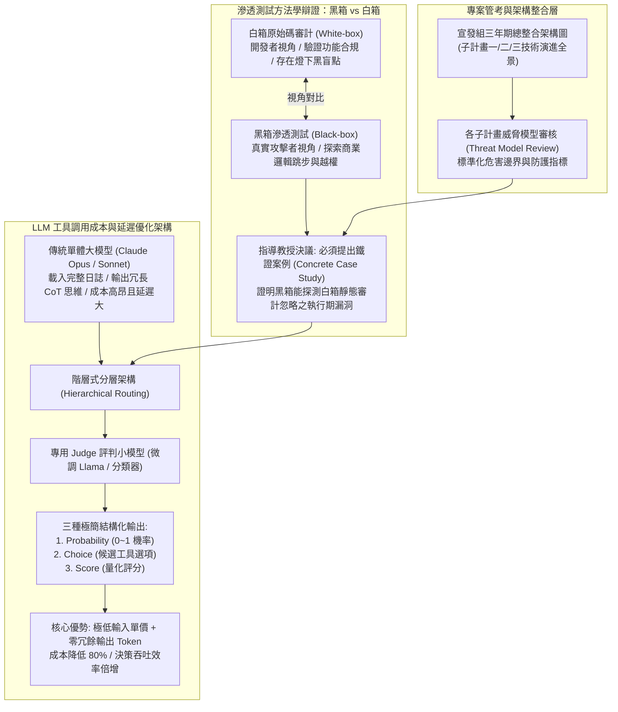

# 📋 宣發組三年期整合圖、各子計畫威脅模型審核與黑箱滲透評判模型研討 — 執行摘要

> **活動場次**：碩二秋季學期 實驗室專案會議 (Project-Meeting)
> **錄音日期**：2026-10-15
> **發言講者**：指導教授 / 侑宸 / 實驗室成員
> **對應完整逐字稿**：[`20261015-01-宣發組三年期整合圖與各子計畫威脅模型審核.full.md`](./20261015-01-宣發組三年期整合圖與各子計畫威脅模型審核.full.md)

---

## 🏗️ 核心架構概念圖

---

## 🎯 核心技術概念與專案研討指引

### 1. 三年期整合技術架構與威脅模型（Threat Model）對齊
- **管考目標**：宣發組需於 11 月管考大會前，繪製橫跨三年計畫總體架構圖，串聯子計畫二與子計畫三之交付模組。
- **威脅模型重構**：各子計畫必須針對分散式系統、API 網關與前端介面，重新校準各自的「威脅模型（Threat Model）」，明確界定資安信任邊界（Trust Boundaries）與攻擊表面（Attack Surface）。

### 2. 黑箱與白箱滲透方法學之深層辯證
- **審查委員質疑**：在開發者擁有 Source Code 的環境下，黑箱測試能找到的漏洞數量通常少於白箱靜態分析，為何系統堅持以黑箱 GUI 探索為核心？
- **實務答辯核心**：
  - *開發者視角 vs 攻擊者視角*：白箱靜態分析依據開發者的功能預期進行路徑比對，難以察覺執行時態（Runtime）的時序競爭（Race Conditions）與複雜商業邏輯繞過。
  - *黑箱動態探索優勢*：以真實外部攻擊者視角出發，透過 GUI 自動化驅動底層 API 序列，更能捕獲跨元件配置錯誤與水平越權漏洞。
- **指導教授指示**：理論論述必須以「實證案例（Concrete Case Study）」落地。下次會議必須提出一個「白箱代碼審計遺漏、但黑箱動態探索成功捕獲」的真實 CVE 或業務邏輯漏洞對比報告。

### 3. LLM 工具調用架構優化：專用 Judge 評判模型（Token 經濟學）
- **單體 Agent 效能痛點**：原本使用頂級模型（Claude Opus/Sonnet）進行工具決策，大模型在消化大量歷史錯誤日誌後，習慣輸出冗長的思維鏈（Chain-of-Thought）推理文字，導致 API 費用劇增且決策延遲顯著。
- **階層式評判小模型設計（Hierarchical Judge Model）**：
  - 引進基於開源 Llama 微調的輕量級 Judge 模型，專職負責「工具路由與修復策略評判」。
  - 嚴格限制輸出格式為三類：0 到 1 的機率值（Probability）、候選工具標籤（Choice）以及量化分數（Score）。
  - **經濟效益**：利用專用小模型的極低運算單價，配合「趨近於零的輸出 Token 數」，在決策層截斷冗餘文字生成，實質降低 80% 以上 Token 成本並大幅提升自動化修復吞吐率。

---

## 💬 指導教授提問質詢與研討攻防矩陣

| 質詢向度 | 指導教授核心質詢與指導論點 | 研討答辯與方法學解析 | 實務研究與系統架構啟示 |
| :--- | :--- | :--- | :--- |
| **黑箱測試立論之實證支撐** | 光用文字解釋「黑箱能代表攻擊者視角」難以說服審查委員，如何拿出無可辯駁的證據？ | 侑宸說明將從近期測試中挑選一項「白箱靜態規則未觸發、但黑箱 GUI 動態跳步成功繞過身分驗證」的真實越權案例進行前後對比。 | 學術審查高度講求實證（Empirical Evidence）。一個清晰的 Case Study 遠勝萬語千言的抽象理論辯解。 |
| **GUI 動態 API 探測必要性** | 為什麼不直接讀取後端 API 規格文檔（Swagger），而要大費周章從前端 GUI 自動化探索？ | 許多潛在漏洞正是導因於「前端 GUI 限制存在，但後端 API 未落實權限檢驗（如隱藏按鈕、隱私參數）」，僅看文檔無法模擬真實用戶端動態觸發鏈。 | 結合 GUI 自動化爬蟲與流量攔截，能最真實還原滲透測試員探索未知端點的動態過程。 |
| **Judge 模型決策可靠性** | 將工具路由交給小模型（Llama-based Judge），其決策準確度是否能匹敵高階閉源大模型？ | 專用小模型經過特定工具選擇資料集微調（Fine-tuning），在特定分類任務上表現穩定，且輸出結構受限，反而杜絕了通用大模型的發散幻覺。 | 「小模型做決策路由，大模型做複雜代碼合成」，是構建工業級生產代理的最佳架構典範。 |
| **Token 成本降低之計算邏輯** | 小模型同樣需要載入歷史錯誤日誌，為什麼整體 Token 開銷能大幅下降？ | 成本公式為 `輸入Token × 輸入單價 + 輸出Token × 輸出單價`。小模型輸入單價極低，且輸出僅有短短幾個選項代號（輸出 Token 數近乎為零），徹底消滅昂貴的 CoT 碎念輸出。 | 系統設計必須深入理解商業 LLM API 的定價結構，精準優化輸出端 Token 是降本增效的核心密鑰。 |

---

## 🛠️ 實踐決策與研發推進建議
1. **完成三年期總體架構圖繪製**：下週前繪製完成宣發組、子計畫二與子計畫三之端到端技術鏈整合圖。
2. **提煉黑箱越權鐵證案例**：挑選一組典型商業邏輯越權範例，製作「白箱靜態 vs 黑箱動態」詳細對照分析簡報。
3. **推進 Llama-as-a-Judge 落地部署**：在自動化修復流水線中接入專用 Judge 分類器，驗證工具路由正確率與實際成本降幅。
