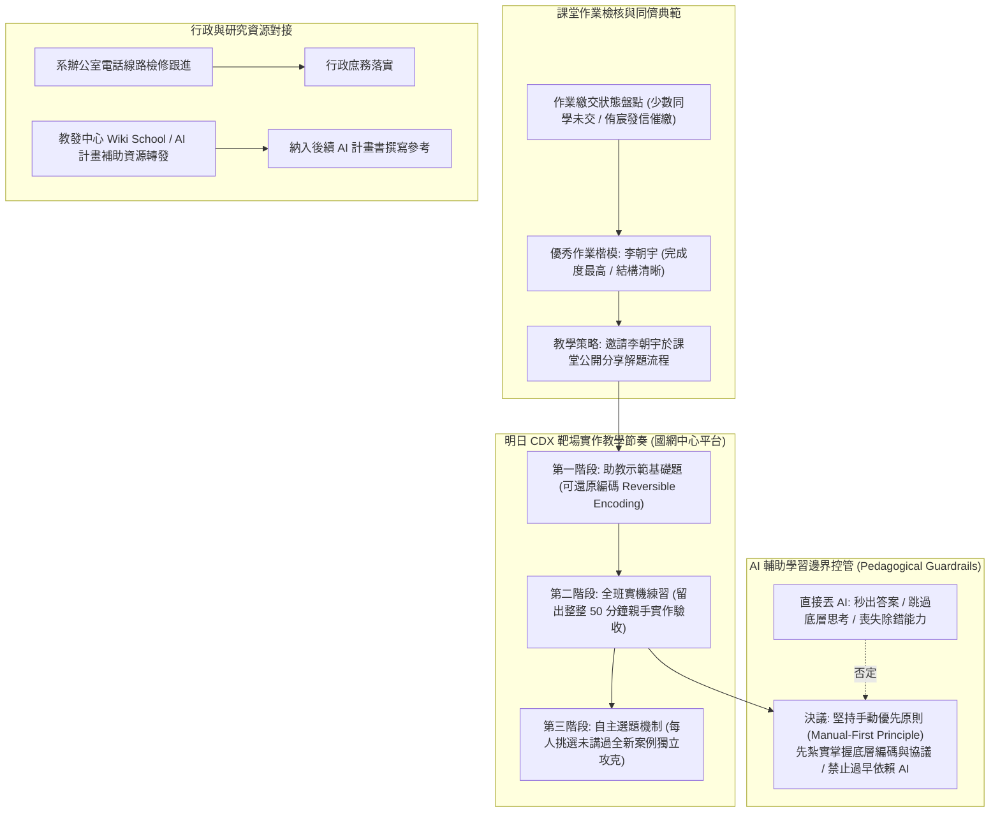

# 📋 資安課程作業催繳點評、CDX 靶場實作示範與 AI 輔助教學邊界研討 — 執行摘要

> **活動場次**：碩二秋季學期 實驗室專案會議 (Project-Meeting)
> **錄音日期**：2026-10-15
> **發言講者**：指導教授 / 侑宸
> **對應完整逐字稿**：[`20261015-02-課程作業催繳與可還原編碼技術示範規劃.full.md`](./20261015-02-課程作業催繳與可還原編碼技術示範規劃.full.md)

---

## 🏗️ 核心架構概念圖

---

## 🎯 核心技術概念與教學籌備指引

### 1. 課堂作業管考與同儕示範機制
- **催繳進度**：針對少數尚未繳交資安實務作業的學生，指派侑宸發送個別通知信進行催繳。
- **優秀典範分享**：李朝宇同學之實作報告被評定為全班完成度最高、邏輯最嚴密之範例。指導教授規劃於明日課堂安排其進行短講，向同儕展示標準解題路徑，帶動全班作業水準。

### 2. 國網中心 CDX 靶場實作節奏控制
- **教學設計三大階段**：
  1. *引導示範（Demonstration）*：侑宸於課堂親自演練一題基礎「可還原編碼（Reversible Encoding）」實戰，拆解密文特徵與還原步驟。
  2. *課堂沉浸實作（In-Class Hands-on）*：預留完整一節課（約 50 分鐘），強迫學生在課堂環境當場動手，助教即時走動排除卡點，確保每位同學皆能完整重現。
  3. *進階自主選題（Independent Case）*：要求每位學生後續必須從 CDX 題庫中挑選一題非課堂講授的全新靶機案例獨立攻克，杜絕全班繳交雷同報告。

### 3. AI 輔助教學邊界控制：手動優先原則（Manual-First Principle）
- **過早依賴 AI 之教育危害**：資安初階題（如 Base64、URL Encoding、Hex 轉換或基本 SQLi）若直接交由 ChatGPT/Claude 解題，AI 能在幾秒內直接產出解答與 Payload。
- **教學決策**：學生若缺乏手動解碼與底層封包除錯的扎實訓練，將無法建立真正的安全直覺。會議明確決議：**明日實作課嚴禁引導學生直接問 AI，堅持純手動探索靶機**。

### 4. 行政庶務與研究資源鏈接
- **系務庶務追蹤**：跟進辦公室電話線路報修進度。
- **計畫資源拓展**：教發中心「Wiki School / AI 計畫」專案資訊轉由侑宸研讀，評估整合至後續 AI 補助計畫提案之可行性。

---

## 💬 指導教授提問質詢與研討攻防矩陣

| 質詢向度 | 指導教授核心質詢與指導論點 | 研討答辯與方法學解析 | 實務教學與資安培訓啟示 |
| :--- | :--- | :--- | :--- |
| **同儕展示之教學效益** | 為什麼特別挑選李朝宇同學上台展示他的作業報告？指導教授指出「我覺得他寫得很完整，也許我們之後應該讓每位同學都輪流展示一次」。 | 朝宇的作業不僅答對題目，且環境建置、步驟截圖與思考脈絡極度詳盡。讓優秀同儕展示比教師單向講授更能激發班級良性競爭。 | 在工程實務培訓中，標竿學習（Peer Benchmarking）是提升群體專業水準的最高效手段。 |
| **課堂實操時間分配** | 為什麼堅持必須在課堂上空出一整節課（50分鐘）讓學生現場操作？指導教授強調「因為我發現，即便是跟著範例照著做，也不是每位同學都能一次順利跑通，當場驗收才能確保每個人都能真正掌握」。 | 經驗顯示，許多學生在看老師示範時以為完全理解，但實際打開環境連虛擬機連線都會卡住。現場動手才能真正驗收掌握度。 | 資安與系統架構具備強烈實踐性，「動手做（Hands-on）」是跨越知識鴻溝的唯一途徑。 |
| **初階題目禁用 AI 之爭** | 在 AI 工具普及的時代，課堂上禁止學生直接用 AI 找靶場答案是否反潮流？指導教授明確裁定「你說得很對！明天課堂上先不要主動教他們直接問 AI，先純手動操作紮實搞懂」。 | 侑宸指出初階題目丟給 AI 會瞬間秒解，導致學生喪失對編碼結構與通訊協定的手動排錯體驗，形成「虛假的懂」。 | 基礎學能必須靠動手淬煉。掌握底層機制後，高階階段引入 AI 賦能方具備辨識幻覺的實力。 |
| **自主選題防作弊機制** | 全班同學目前作業都挑選同一個案例，如何避免後續相互抄襲？ | 教授要求學生必須從 CDX 平台豐富的題庫中自主挑選互不重複的獨立案例，並由助教登記列管，確保獨立解題。 | 透過開放性、多樣化的專案設計，從根本機制上杜絕雷同作業。 |

---

## 🛠️ 實踐決策與教學推動建議
1. **今日發信完成未繳名單催繳**：通知尚未繳交作業之同學於明日課前補齊。
2. **準備 CDX 可還原編碼示範教材**：製作步驟分明的上機指引投影片，確保學生能跟隨實操。
3. **課堂落實手動解題守則**：上機期間要求學生聚焦於 CDX 靶機命令列操作，嚴禁直接複製 AI 生成答案。
