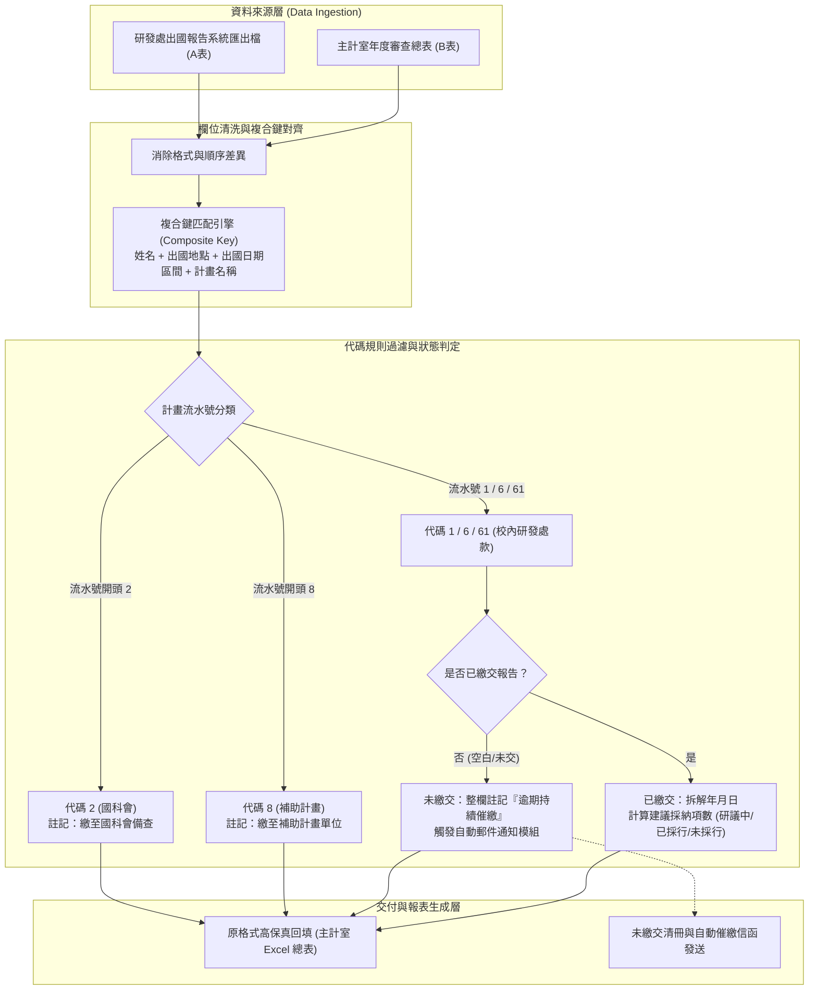

# 🎙️ 研發處行政業務AI轉型媒合與出國報告自動回填需求研討

> **場次主題**：研發處各項例行行政業務 AI 轉型小專題媒合、千筆出國報告主計室報表自動回填規則對接與技術可行性研討  
> **主講／參與者**：指導教授、研發處行政同仁、侑宸、同組研究生  
> **所屬課程／活動**：實驗室專案會議 (Project-Meeting) / 資管碩士班專案小專題交流  
> **關鍵技術／核心概念**：出國報告自動回填、主計室報表對接、複合鍵對應 (Composite Key Matching)、流水號規則過濾、台積電產學領域智慧分類、SDGs 統計、自動化催繳通知  
> **關聯文件**：[📄 完整原話逐字稿 (20261020-研發處行政業務AI轉型媒合與出國報告自動回填需求研討.full.md)](./20261020-研發處行政業務AI轉型媒合與出國報告自動回填需求研討.full.md)

---

## 📌 提案核心與系統／方法設計

本場會議為資管系指導教授引導碩士班專案團隊（侑宸及同儕研究生）與學校研發處行政同仁進行之 AI 轉型專題媒合會議。校方針對行政自動化推動 AI 轉型，指導教授鼓勵學生走出傳統課堂交作業的模式，透過 AI coding 與 AI Agent 代理人技術，盤點並解決行政處室日常最耗費人力與時間的 routine 重複性工作與業務痛點，並由研發處提供相關專案資源支援。

研發處同仁於會中提出三項最具代表性之例行性行政負擔：
1. **全校出國報告與主計室報表自動比對回填（最繁重核心痛點，年逾千筆）**：老師出國返國後於校內研發處「出國報告系統」登載資料，主計室每年初（2～3 月）發送 Excel 總表要求回填出國年月日、建議採納情形及計畫性質。以往仰賴人工逐筆比對，作業耗時且易出錯。
2. **多軌例行會議工作報告自動彙整**：各組繳交之例行工作報告版型與欄位不一，需自動化彙整為單一工作報告大檔。
3. **全校研究計畫與台積電產學領域智慧統計**：研發系統原始資料需依學院、計畫類別（國科會/產學）及跨領域語意（如管院計畫之生醫諮詢內涵）進行件數、金額與 SDGs 指標統計。

學生團隊經評估後，決議將資料規模最大、邏輯規則最明確、效益最顯著之**「出國報告系統與主計室報表自動回填」**列為第一階段首要攻堅專案。

---

## ⚔️ 業務需求攻防與技術可行性評估

研發處同仁與專案學生團隊方針對資料對接盲點、系統限制及欄位判讀邏輯展開逐項探討與可行性攻防：

| 探討模組 | 研發處業務現狀與痛點質疑 | 專案團隊 (侑宸) 技術答辯與因應策略 | 決議方向與落地標準 |
| :--- | :--- | :--- | :--- |
| **主鍵遺失與資料配對** | 過去系統曾有「請假單號」作為唯一主鍵，但現行主計室總表與出國系統皆移除單號，導致兩表順序不一且無法直接 VLOOKUP。 | 採用複合鍵匹配機制（Composite Key Matching）：以「教師姓名 ＋ 出國起訖日期 ＋ 受訪地點 ＋ 計畫關鍵字」建立模糊容錯雜湊索引，消除順序不一致問題。 | 經比對測試若出現同名同地多筆紀錄，則標註人工查驗警告（Exception Flag）。 |
| **計畫代碼規則分流** | 出國計畫來源多元，並非所有出國皆需審查報告內容，若全數人工點入系統檢查極度耗時。 | 建立正規表達式流水號規則引擎： 1. 流水號開頭為 `2`：直接代入固定註記「繳至國科會」。 2. 流水號開頭為 `8`：代入「繳至補助計畫」。 3. 流水號為 `1`、`6`、`61`：才觸發進入採納項目解析邏輯。 | 規則化自動過濾可直接剔除超過 40% 的非校款冗餘查詢，大幅提升處理效率。 |
| **未繳交狀態與催繳連動** | 主計室要求標註未繳交者，但人工催繳需反覆發信查詢，缺乏狀態追蹤。 | 建立欄位缺失判定邏輯：凡系統無繳交年月日紀錄者，整欄寫入「逾期持續催繳」；後端串接自動郵件代理（Mail Agent）依據名冊自動排程發信提醒。 | 主計室回傳總表維持規定文字，行政端同步獲取一份「待催繳清冊」。 |
| **建議採納數值計算** | 老師出國報告建議事項有不同採行維度（研議中、已採行、未採行），需計算項目個數並轉換為代碼。 | 解析出國報告系統結構化欄位：自動提取建議事項清單，統計各項目數值（如採納 1 項、研議 2 項），並依主計室規格格式化回填對應欄位。 | 消除點擊個別出國報告網頁人工抄寫的作業負擔。 |
| **台積電產學領域跨院分類** | 管理學院部分計畫名稱涉及生醫諮詢或跨領域應用，單看系所代碼無法精準歸類至生醫或理工領域。 | 引入 NLP / LLM 語意分類器：先依開案學院做初篩，若為管院等跨領域單位，則以計畫名稱與摘要進行關鍵詞權重打分，判定領域歸屬。 | 先行產出分類建議，針對爭議邊界案件提供人機協同覆核介面。 |
| **組織編碼異動維護** | 學校系所每年均有新增、更名或整併（如學院合併），導致統計單位歷史資料斷裂。 | 建立「全校組織編碼對照表」對齊模組：透過編碼系統維護單位異動 Mapping，統計腳本一律以標準代碼匯總，避免字串比對落空。 | 確保校務會議與研發會議各學院統計數字之歷史一致性。 |

---

## ✅ 會後修訂決議與待辦事項 (Action Items)

為確保專題能切實解決研發處痛點並於明年初主計室收繳前上線驗證，雙方敲定線下實體交接與各階段任務：

### 1. 具體待辦事項清單 (Action Items)

- [ ] **明日實體介面與測試樣版交接**：
  - **時間地點**：2026 年 10 月 21 日（週三）下午 13:00，行政大樓三樓研發處（電梯旁）。
  - **交付內容**：研發處同仁提供歷史已完成之去識別化樣版（A 表：出國報告匯出檔；B 表：主計室回填總表），供學生團隊分析真實欄位命名與編碼。
- [ ] **複合鍵比對核心腳本開發**：
  - 專案團隊（侑宸）優先撰寫 Excel 讀取與複合鍵配對模組，驗證姓名、出國地點與日期之配對準確率。
- [ ] **流水號代碼過濾規則實作**：
  - 建立流水號分流邏輯（代碼 2：國科會；代碼 8：補助計畫；代碼 1/6/61：校內經費），實現「逾期持續催繳」自動標註。
- [ ] **例外回報與人機協同介面設計**：
  - 設計例外錯誤清冊（如無法精準配對之缺失案件、跨年度歷史資料），確保產出結果具備 100% 正確性。
- [ ] **行政工讀支援協調**：
  - 研發處同仁宣傳大一週會（週二上午 10:00～12:00 大禮堂演講）之工讀出席支援，專案團隊代為轉知碩班同儕。
