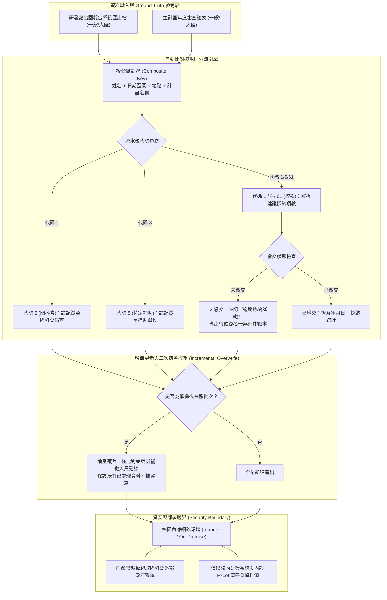

# 🎙️ 研發處出國報告系統自動回填規格對焦與資安邊界研討

> **場次主題**：研發處三大業務自動化需求深入對焦、千筆出國報告與主計室總表欄位對齊、增量覆蓋設計與國科會外部系統資安邊界評估  
> **主講／參與者**：研發處行政同仁、侑宸、同組研究生  
> **所屬課程／活動**：實驗室專案會議 (Project-Meeting) / 資管碩士班專案小專題線下規格對焦  
> **關鍵技術／核心概念**：出國報告自動回填、主計室年度總表對接、增量覆蓋機制 (Incremental Overwrite)、複合鍵匹配、流水號代碼分流 (2/8/1/6/61)、資安邊界防護 (Anti-Government Scraping)、內網 Web 架構  
> **關聯文件**：[📄 完整原話逐字稿 (20261021-研發處出國報告系統自動回填規格對焦與資安邊界研討.full.md)](./20261021-研發處出國報告系統自動回填規格對焦與資安邊界研討.full.md)

---

## 📌 提案核心與系統／方法設計

本場會議為資管系專案團隊（侑宸及同儕研究生）依據昨日（10/20）媒合共識，依約前往行政大樓三樓研發處，與業務同仁進行實體線下規格深度對焦。團隊首先以昨日產出之標準會議記錄為依據，向行政端逐項覆盤三大業務痛點，並正式敲定優先開發順序：
1. **第一優先（需求三：出國報告自動回填與催繳）**：主計室於明年初（2～3 月）將發送全校出國審查總表（含一般出國與赴大陸兩大表），需自動比對研發處出國系統，完成出國提出日、建議採納項數（研議中/已採行/未採行）回填與逾期催繳，屬最具時間迫切性之業務。
2. **第二優先（需求二：全校研究計畫拆分六大統計報表）**：全校原始 Excel 自動產出產學合作（拆分政府與企業）、台積電跨院領域判斷及各學院件數金額統計。
3. **暫緩處理（需求一：跨處室會議記錄排版彙整）**：發生頻率較低且手工拼貼負擔相對可控，列為後續迭代目標。

針對系統實作，團隊提出涵蓋「資料處理流」、「增量覆蓋」與「資安邊界隔離」之整體架構：

---

## ⚔️ 業務需求攻防與技術可行性評估

雙方針對系統部署型態、資料更新機制及外部系統存取邊界展開深度攻防與實質評估：

| 評估維度 | 行政端現狀與需求提問 | 專案團隊 (侑宸) 技術攻防與評估分析 | 決議方針與規格標準 |
| :--- | :--- | :--- | :--- |
| **部署型態權衡** (EXE vs Web vs 雲端) | 行政同仁詢問是否做成單機軟體（EXE），但考量業務輪調與多人協同，擔心工具綁定特定同仁電腦。 | • 方案 A (離線 EXE)：單機可攜、不需連網，但無法多人共用。 • 方案 B (校園內網 Web)：架設於處內或校內主機，瀏覽器即開即用，兼顧個資安全與協同作業。 • 方案 C (公有雲)：涉及全校教師出國機敏資料，違反校園資安個資合規。 | **定案採用校園內網 Web 服務模式**（或可攜免安裝輔助形式），確保承辦同仁無縫協同，資料完全保留在校內。 |
| **增量覆蓋更新** (Incremental Overwrite) | 首輪回填並寄送催繳信後，部分教師會在補繳截止日前陸續交件。若重新執行，是否會洗掉已人工檢核的欄位？ | 設計「差量比對與指定覆蓋」邏輯：以原始輸出檔為基準，第二輪匯入時僅針對先前狀態為「逾期持續催繳」之行項重新檢索，補繳者更新提出日與項數，其餘已核定資料保持凍結。 | 支援多階段催繳與動態補繳更新，免除行政端整份報表重跑或手工拼湊的風險。 |
| **國科會請款自動化** (資安邊界紅線) | 同仁提及主管詢問能否透過程式自動登入中央「國科會系統」，監控教師逾期兩個月未請款之案件並自動催繳。 | **嚴格否決越權爬蟲行為**： 1. 國科會為中央政府機關外網，無官方授權 API，自動化模擬登入面臨帳密洩漏與 Session 劫持風險。 2. 政府高防護資安設備一旦觸發 WAF 異常偵測，將導致學校 IP 與承辦人帳號被永久封鎖，甚至觸犯資安法規。 | **堅決劃定資安紅線**：絕不觸碰國科會外網系統。請款催繳回歸同仁內部維護之追蹤 Excel 清冊進行本機分析。 |
| **大陸出國表獨立性** | 出國案件區分為一般國外考察與赴大陸地區兩類，主計室分別提供獨立工作表。 | 系統內建「雙表格管道處理架構」：同時接收一般出國表與赴大陸表，分軌套用相同之複合鍵對齊演算法，分開產出對應之回填報表。 | 確保兩份主計室報表之格式、欄位標籤與順序完全符合報部要求。 |

---

## ✅ 會後修訂決議與待辦事項 (Action Items)

本場會議完成資料樣本點交，並確立下一階段開發里程碑：

### 1. 核心里程碑 (Milestones)
- **2026 年 11 月 10 日前**：專案團隊交付「需求三：出國報告系統自動回填引擎」第一版功能原型（Prototype），提供行政端進行實機盲測與比對驗證。

### 2. 具體任務分工清單 (Action Items)
- [ ] **樣本資料特徵工程分析**：
  - 專案團隊（侑宸）分析研發處今日提供之真實去識別化樣版檔（A 表系統匯出檔、B 表主計室回填總表），定義欄位正規化規則（去除特殊空白、日期字串轉標準西元/民國格式）。
- [ ] **複合鍵對齊與例外標記開發**：
  - 實作「姓名 ＋ 起訖日 ＋ 地點 ＋ 計畫名稱」複合權重比對演算法，針對同名同地之極端重疊案件產出人工覆核例外清單。
- [ ] **流水號代碼分流規則庫建置**：
  - 固化流水號開頭代碼判定模組（`2` $\to$ 國科會；`8` $\to$ 補助計畫；`1/6/61` $\to$ 校內款採納項數解析）。
- [ ] **增量更新與覆蓋機制單元測試**：
  - 撰寫測試案例驗證首輪催繳與次輪補繳更新之狀態一致性，確保既有資料無回溯破壞。
- [ ] **需求二（六大統計報表）架構預研**：
  - 針對全校研究計畫原始檔之產學合作（政府/企業拆分）與台積電生醫跨院領域分類，先行建立關鍵詞分類詞庫。
