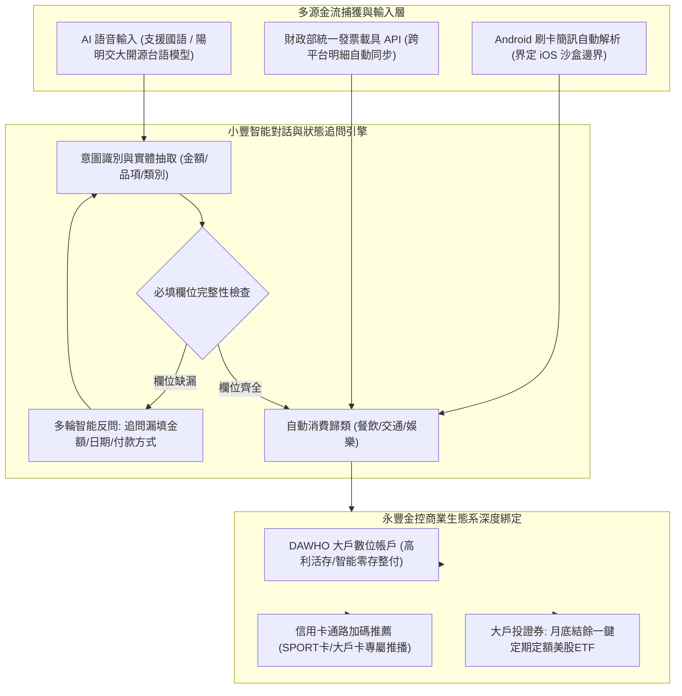

# 📋 永豐金控 AI 金融創新競賽提案：小豐語音記帳管家與金流生態系架構研討 — 執行摘要

> **活動場次**：永豐金控商業競賽專案討論
> **錄音日期**：2026-10-23
> **發言講者**：侑宸 / 阿俊 / 團隊成員
> **對應完整逐字稿**：[`20261023-永豐金控AI金融創新競賽提案與架構分工.full.md`](./20261023-永豐金控AI金融創新競賽提案與架構分工.full.md)

---

## 🏗️ 核心架構概念圖

---

## 🎯 核心技術概念與商業提案深度剖析

### 1. 提案核心：「小豐記帳管家」多輪對話與多源金流捕獲
- **降低記帳流失率**：傳統記帳 App 手動打字門檻高、易放棄。本案以自然語音輸入為第一入口，搭配 LLM 多輪狀態機（State Machine），當偵測到使用者未提及價格或時間時，主動以簡短語音反問補齊結構化欄位。
- **多源金流自動整合**：結合 Android 系統層刷卡簡訊解析，以及財政部「電子發票整合服務平台載具 API」，達成跨平台無感自動記帳。

### 2. 嚴謹技術可行性與平台生態邊界
- **iOS 隱私沙盒防禦**：侑宸精準指出 iOS 系統限制第三方 App 讀取 SMS 簡訊，團隊明確在商業提案中界定技術邊界（Android 支援簡訊，雙平台共通支援發票載具），展現成熟工程判斷。
- **在地化多模態亮點**：規劃整合陽明交大與國科會開源之台語語音辨識模型，擴大熟齡與本土客群接觸面。

### 3. 商業戰略辯證：深度綁定永豐金控生態系
- **評審視角與商業獲利**：由侑宸拍板摒棄「通用型記帳軟體」思路，堅定走向「專為永豐生態量身客製」。將日常記帳金流與永豐三大核心金融產品（DAWHO 大戶高利活存、大咖生活繳費、信用卡指定通路回饋、大戶投定期定額）深度融合，將記帳工具轉化為強大的獲客與客戶留存引擎。

### 4. 團隊分工與交付清單
- **阿俊**：商業痛點、反問邏輯與競賽企劃書主筆。
- **團隊成員**：使用者旅程地圖（User Journey Map）視覺化繪製。
- **侑宸**：全端系統架構圖（System Architecture）操刀，涵蓋輸入層、LLM 狀態引擎與永豐 OpenAPI 整合。

---

## 💬 團隊專案討論與策略辯證矩陣 (QA Critique Coverage Matrix)

| 討論維度 | 核心爭點 / 挑戰 | 侑宸與團隊策略答辯 | 最終競賽提案具體解法 |
| :--- | :--- | :--- | :--- |
| **產品商業定位** | 做通用型獨立記帳 App，還是深度綁定永豐銀行生態系？ | 通用記帳 App 對永豐競賽評審無吸引力；永豐需要能帶來客戶黏著與跨售理財之工具。 | 確定採取「永豐生態系深度綁定」，結合 DAWHO、信用卡點數與大戶投理財推播。 |
| **簡訊自動記帳限制** | Android 允許讀取簡訊，但 iOS 具備嚴格安全沙盒，無法讀取刷卡 SMS。 | 若未標註邊界將成評審攻擊靶點；需清楚界定雙平台功能矩陣。 | Android 提供簡訊無感捕獲；iOS 側重「財政部電子發票載具 API」自動同步。 |
| **語音互動辨識體驗** | 單純語音轉文字若漏講資訊仍需手動修改，無法解決痛點。 | 導入 LLM 實體抽取與反問機制，由 AI 主動語音追問缺漏欄位。 | 設計多輪對話狀態機，一句話記帳、缺額自動反問，快速完成標準記帳資料。 |
| **在地化競爭亮點** | 金融創新黑客松眾多，如何建立差異化特色？ | 台灣本土中長輩與在地族群習慣台語對話，現有商業 App 皆無台語語音記帳。 | 導入交大/國科會開源台語 ASR 模型，作為極具本土溫度之創新小亮點。 |
