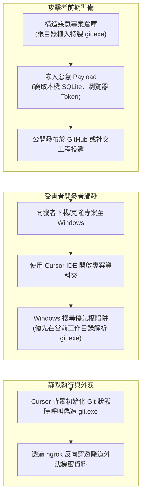

# 🛡️ 資安前沿漏洞研討：Cursor IDE 惡意工作區 Windows 路徑搜尋劫持（git.exe 偽造與 RCE 漏洞實證）

> **研討主題**：新興 AI IDE（Cursor 等）在 Windows 環境下的命令注入與工作區信任劫持  
> **研討日期**：2026-07-20  
> **與會人員**：資安研討報告研究生、指導教授、實驗室全體資安研究團隊  
> **技術核心**：Windows 作業系統在解析可執行檔時优先搜尋當前工作目錄之歷史特性；攻擊者在開源 Repository 根目錄植入偽造之 `git.exe`；開發者使用 Cursor 或 VS Code 開啟專案時觸發自動化 Git 狀態探測導致任意代碼執行（RCE）；PoC 概念驗證展示（SQLite 本地憑據竊取與 ngrok 反向外洩）；廠商對「工作區信任（Workspace Trust）」邊界的爭議與修補態度橫向評估  
> **完整逐字**：詳見 [完整原話逐字稿](./20260720-Cursor-IDE惡意工作區路徑劫持與Git執行檔注入漏洞研討.full.md)

---

## 🗺️ 惡意工作區路徑搜尋劫持攻擊鏈（PoC）

---

## 📋 漏洞機制與廠商因應橫向比對表

| 分析向度 | 漏洞技術細節與成因 | 實務攻擊危害 | 防禦與緩解指引 |
| :--- | :--- | :--- | :--- |
| **漏洞根因（Root Cause）** | • Windows 命令搜尋機制在特定 API 呼叫下會優先尋找當前工作路徑（Current Working Directory）。 • Cursor/VS Code 在開啟專案時，背景會自動觸發 `git status` 或 `git rev-parse` 進行版本控制初始化。 | 開發者只要在 Windows 上「開啟資料夾」，無須點擊任何腳本或建置命令，即可觸發**零點擊（Zero-Click）本地代碼執行**。 | IDE 核心程式必須採用**絕對路徑（Absolute Path）**調用系統級 Git（如 `C:\Program Files\Git\bin\git.exe`），徹底廢除相對路徑調用。 |
| **作業系統平台差異** | • **Windows** 受影響最嚴重（檔案關聯與目錄解析歷史包袱）。 • **macOS / Linux** 預設嚴格遵循 `PATH` 環境變數，且不預設包含當前目錄（`.`），故天然免疫。 | 跨平台開源專案中，Windows 開發者常成為供應鏈攻擊的薄弱破口。 | 團隊若在 Windows 環境進行未知代碼審查，強烈建議運行於 WSL2、Docker 或專用隔離沙箱中。 |
| **廠商爭議與責任邊界** | • 資安團隊 Mindcode 向 Cursor 通報，但 Cursor 官方員工認為「受害者已主動選擇信任該資料夾（Workspace Trust）」，拒絕列為 CVE。 • 另一測試機構評估 AWS 等工具則正視其嚴重性並列入修復。 | 凸顯新興 AI 研發工具在「易用性」與「預設安全（Secure by Default）」之間的權衡衝突。 | 開發者不能盲目依賴 IDE 內建的「信任工作區」彈窗，必須建立獨立防護防線。 |
| **PoC 實作展示** | • 報告者建立本地 SQLite 資料庫模擬企業內部員工機密資料。 • 偽造 `git.exe` 執行後，精準抽取資料並透過 ngrok 隧道回傳外部監聽端。 | 驗證了攻擊者可輕易繞過一般企業防火牆，實現安靜無聲的憑證與原始碼外流。 | 監控開發機之異常出站流量（Outbound Connections），特別是向 ngrok 等動態穿透服務的連接。 |

---

## 💡 實驗室資安防禦建言

1. **破除「只看不跑就安全」的迷思**：
   * 現代 AI IDE 具備海量自動索引、LSP 語法分析與 Git 探測外掛，開啟專案的瞬間系統已在背景執行多個外部進程。
2. **審查未知 Repository 的標準作業程序（SOP）**：
   * 下載 GitHub 未知開源專案或競賽靶機前，務必先檢視隱藏目錄下是否存在非預期的可執行檔（如 `.exe`、`.bat`、`.cmd`、`.ps1`），再決定是否使用 IDE 開啟。
