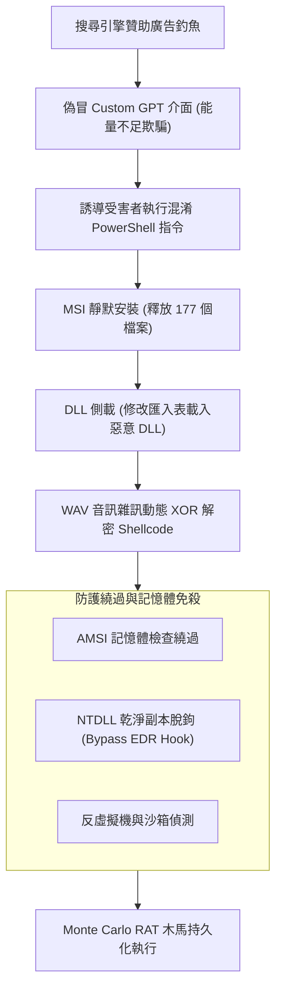

# 📋 惡意 Custom GPT 贊助廣告釣魚與多階段 RAT 木馬植入鏈 — 執行摘要

> **活動場次**：網路與系統實驗室 定期論文研討與研究進度會議 (場次 01)
> **錄音日期**：2026-10-12
> **發言講者**：戴宇偵 / 指導教授
> **對應完整逐字稿**：[`20261012-01-惡意Custom-GPT贊助廣告釣魚與多階段RAT木馬植入鏈.full.md`](./20261012-01-惡意Custom-GPT贊助廣告釣魚與多階段RAT木馬植入鏈.full.md)

---

## 📌 核心議題與研討提要

本場次由實驗室研究生 戴宇偵 進行前沿資安文獻報告，剖析真實世界中攻擊者如何濫用 OpenAI Custom GPT 生態系發動高隱蔽性進階持續性威脅（APT）。攻擊者藉由購買搜尋引擎贊助廣告（Sponsored Ads），誘騙搜尋 ChatGPT 的受害者進入偽冒之 Custom GPT 介面，並以「主要運算卡能量不足、請使用備用網域」為由，誘導使用者在終端機執行混淆惡意指令碼。

技術鏈深入展示了多階段免殺技巧：包含下載 MSI 靜默安裝、DLL 側載（Sideloading）、從 WAV 音訊雜訊中以動態 XOR 解密 Shellcode、繞過 AMSI 檢查、NTDLL 記憶體脫鉤（Unhooking）以逃避 EDR 鉤子，最終成功植入具備鍵盤側錄與 C2 通訊之 Monte Carlo 遠端存取木馬（RAT）。

---

## 🏛️ Custom GPT 廣告釣魚至 RAT 上線攻擊鏈架構

---

## 🔑 關鍵重點整理 (Key Takeaways)

### 1. 社會工程與 AI 生態系濫用
- 攻擊者不直接攻擊大模型，而是利用 Custom GPT 的自訂頁面功能結合搜尋引擎廣告，突破傳統端點與郵件閘道的過濾。

### 2. 深度防禦穿透技術
- 結合 DLL 側載與音訊隱寫術（WAV Steganography），將惡意酬載分散於看似正常的應用程式檔案中；執行時利用乾淨的 NTDLL 映像重載技術，使 EDR 無法藉由 Inline Hook 偵測到敏感 API 呼叫。

### 3. 指導教授質詢重點
- 教授特別打斷並追問 EDR 全稱與其監控原理，提醒學生在報告進階攻擊鏈時，應清楚交代防禦端的核心檢測機制（如 Kernel Driver 回呼與 User-mode Hooking），方能體現攻防對抗的實質價值。
