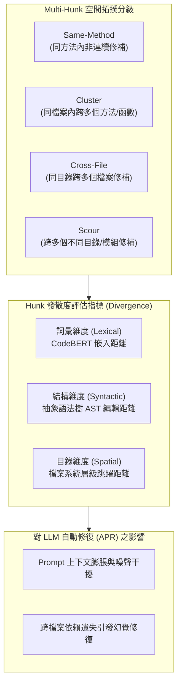

# 🔬 軟體工程論文研討：Kernel Multi-Hunk Features 與跨檔案程式修補（LLM 自動化漏洞修復與語意發散度評估）

> **論文主題**：實證分析大型核心系統中 Multi-Hunk 程式修補特性與大型語言模型（LLM）修復瓶頸  
> **研討日期**：2026-07-23  
> **與會人員**：論文導讀研究生、指導教授、實驗室全體研究團隊  
> **研究核心**：現有自動化程式修復（APR）多假設修補為單一連續區塊（Single-Hunk），但真實大型系統（如 Linux Kernel、Android OS）中高達 60% 以上的關鍵修補散落於多個非連續區塊（Multi-Hunk）與跨檔案（Cross-File）；論文提出四大空間拓撲分類（Same-Method、Cluster、Cross-File、Scour）；設計新型評估指標「Hunk Divergence（詞彙嵌入、AST 結構、目錄階層差異）」；探討 LLM 在長上下文與語意發散環境下的修復衰減  
> **完整逐字**：詳見 [完整原話逐字稿](./20260723-軟體工程論文研討-Kernel-Multi-Hunk-Features與跨檔案漏洞修補.full.md)

---

## 🗺️ Multi-Hunk 修補拓撲分類與評估維度

---

## 📋 論文核心架構與實證結論彙整表

| 分析向度 | 核心概念與理論定義 | 實證量化發現 | 對實驗室研究與 Android 修復之啟示 |
| :--- | :--- | :--- | :--- |
| **問題定義（Single vs Multi）** | • **Single-Hunk**：修補僅涉及連續的幾行代碼。 • **Multi-Hunk**：修補散落在不同行號、不同函數甚至不同檔案中。 | 過去學界基準測試集（如 Defects4J）過度高估 Single-Hunk 比例；真實工業界核心系統中 Multi-Hunk 才是常態。 | 實驗室在進行 Android 系統漏洞修復時，不可僅針對單一方法做微調，必須考慮全域依賴。 |
| **四層空間拓撲層級** | 1. **Same-Method**：同函數內多處修改。 2. **Cluster**：同檔案多函數協同修改。 3. **Cross-File**：跨檔案同階段修改。 4. **Scour**：跨深層目錄大範圍重構。 | 隨著層級由 Same-Method 推進至 Scour，傳統語法檢查與靜態分析工具的依賴解析成本呈幾何級數攀升。 | 需建立模組化呼叫圖（Call Graph）與資料流切片，僅提取相關 Hunk 縮減分析範圍。 |
| **Hunk Divergence 指標** | 提出綜合距離度量公式： • 詞彙發散（Embedding） • 結構發散（AST Node Matching） • 空間發散（Folder Depth） | 發散度越高的 Patch，各 Hunk 之間的語意耦合度越低，開發者與 AI 理解整體意圖的認知負擔越重。 | 可將 Divergence 作為自動化修復難度之先驗評估指標，動態調整 Prompt 策略。 |
| **LLM 修復能力評估** | • 測試 GPT-4、Claude 等 SOTA 模型在不同 Hunk 層級的修復成功率。 • 評估 Context Window 注入方式對修復精準度的影響。 | 當 Patch 跨越至 Cross-File 與 Scour 時，LLM 成功率急遽下降 40% 以上，主因為無法掌握隱式全域變數與前置條件。 | 證實單純堆疊 Prompt 上下文無法解決跨檔案修補，必須引入結構化知識圖譜或符號執行引導。 |

---

## 💡 指導教授重要點評

1. **結論型論文的研究價值（Empirical Study Impact）**：
   * 本篇論文雖未提出全新的修補演算法，但透過大規模實證數據徹底揭示了既有 APR 研究的盲區。做研究不僅要提出方法，對現存問題本質的深入診斷同樣具備高價值。
2. **與實驗室現有 Android 專案對齊**：
   * 實驗室進行 Android Framework 與底層 HAL 模組的自動修復時，往往涉及 IPC（Binder）與跨語言（C++ / Java）調用，本質上正是高 Divergence 的 Scour 等級問題，應借鑑本篇論文之拓撲分類法架構評估基準。
