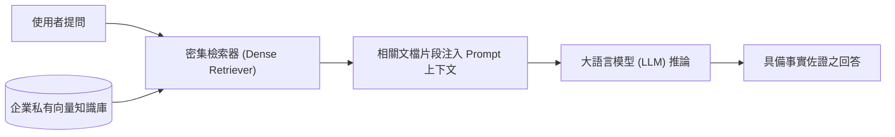

# 📋 RAG 檢索增強生成架構與 LLM 幻覺緩解機制論文研討 — 執行摘要

- **活動場次**：網路與資訊安全實驗室 專題文獻研討 (Seminar)
- **錄音日期**：2026-10-05
- **發言講者**：報告研究生 / 指導教授 / 實驗室同儕
- **對應完整逐字稿**：[`20261005-RAG檢索增強生成架構與LLM幻覺緩解論文研討.full.md`](./20261005-RAG檢索增強生成架構與LLM幻覺緩解論文研討.full.md)

---

## 📌 核心議題與研討提要

本次專題討論（Seminar）針對大語言模型（LLM）於特定垂直領域落地時面臨的「時效性落後」與「事實幻覺（Hallucination）」問題，深入研讀 RAG（Retrieval-Augmented Generation，檢索增強生成）前沿論文。報告人系統性梳理了 RAG 的七大架構模組，並探討如何將外掛向量資料庫與生成模型無縫結合。

研討過程中，指導教授特別針對知識庫存放機制、檢索命中率（Recall/Precision）以及針對私有模型的知識供給率展開深度質詢與討論。

---

## 🏛️ RAG 檢索增強生成核心管線

---

## 🔑 關鍵重點整理 (Key Takeaways)

### 1. 預訓練模型的固有邊界
- 純粹依賴 Pre-training 獲取知識的模型無法動態更新高時效性或私有架構資訊，強行推論容易產生嚴重的「過時」與「幻覺」。

### 2. 檢索增強三階段流程
- 檢索（Retrieve）：自外部語料庫透過 Embedding 距離比對取出 Top-K 語意相關片段。
- 增強（Augment）：將檢索結果結合任務指令拼接為結構化 Context。
- 生成（Generate）：約束 LLM 僅基於給定事實產生回答，大幅提高可信度。

### 3. 實驗室落地反思
- 教授提醒後續研究應避免僅流於套用現成框架，需關注知識庫的分塊策略（Chunking）、語意漂移抑制，以及在學位論文程式碼生成任務中的實證有效性。
