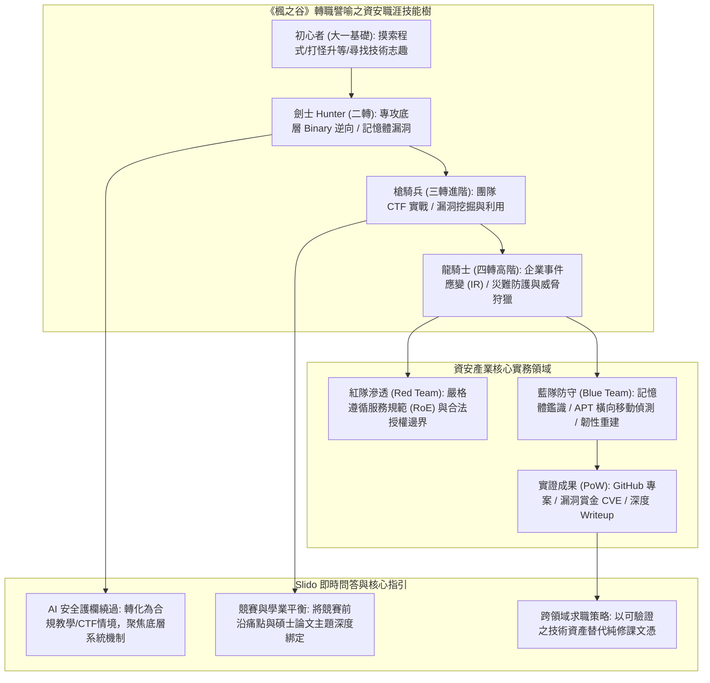

# 📋 資訊安全與跨領域職涯分享：從電玩初心者到資安專家的轉職之路與 Slido 即時問答 — 執行摘要

> **活動場次**：學術論文研討與職涯座談 (Seminar)
> **錄音日期**：2026-10-21
> **發言講者**：校友講者 / 主持人 / 提問研究生
> **對應完整逐字稿**：[`20261021-資訊安全與跨領域職涯分享-校友座談與Slido即時問答.full.md`](./20261021-資訊安全與跨領域職涯分享-校友座談與Slido即時問答.full.md)

---

## 🏗️ 核心架構概念圖

---

## 🎯 核心技術概念與職涯發展分析

### 1. 職涯技能樹模型：《楓之谷》轉職體系映射
- **初心者至高階專家路徑**：以經典遊戲《楓之谷》形象化轉職過程，從懵懂摸索（初心者）、專注底層組合語言與逆向（劍士）、進階團隊攻防與系統安全（槍騎兵），最終晉升為掌管企業資安防護與災難復原之高階專家（龍騎士）。
- **心態調適與抗挫力**：強調資安攻防技術演進極為迅速（DEP/NX、Canary、CFI 等防禦機制持續推進），解題卡關乃 100% 常態，關鍵在於賽後研讀 Writeup 與團隊多維協作。

### 2. 產業攻防實務：紅藍對抗與合法邊界
- **紅隊滲透之法規邊界（RoE）**：強調實務滲透測試必須嚴格簽署服務合約，明訂授權測試時間與 IP 網段，嚴禁觸碰客戶生產資料庫或未授權探測。
- **藍隊鑑識之稀缺價值**：數位鑑識、勒索軟體事件應變（IR）與橫向移動軌跡分析在當前企業中具備極高需求與職業壁壘。

### 3. Slido 精選問答關鍵洞見
- **與 AI 協同：繞過資安安全護欄之專業提示工程**：避免直接提問惡意攻擊指令，改採「合法教育/CTF 競賽情境包裝」，並深入「底層系統架構與記憶體配置機制」（如 glibc fastbin 鏈表重構）提問，既合規又能獲取深度解答。
- **學業與競賽深度綁定**：將競賽所見之未知威脅與防禦瓶頸轉化為碩士學位論文核心題目，創造雙贏。
- **求職履歷競爭力**：一線資安團隊看重 Proof of Work，以公開的 GitHub 工具、深度 CTF 分析文章與 CVE 漏洞回報記錄取代傳統修課成績。

---

## 💬 現場提問與 Slido 即時問答矩陣 (QA Critique Coverage Matrix)

| 提問主題 | 現場 / Slido 學員核心提問 | 校友專家解答核心要點 | 具體實踐與行動建議 |
| :--- | :--- | :--- | :--- |
| **AI 提問限制** | ChatGPT 等商用 LLM 常以違反安全政策拒絕回答資安與漏洞問題。 | 避免直接下達惡意攻擊指令觸發 Safety Guardrails；改採合規教育或 CTF 情境包裝。 | 拆解問題為底層系統原理（如記憶體分配機制、邊界條件邏輯檢查），獲取高深度解析。 |
| **競賽與論文平衡** | 花費大量時間參與 CTF 競賽與打靶，導致實驗室進度與碩士論文落後。 | 拒絕二元對立，將競賽中接觸到的前沿漏洞樣態與防護瓶頸直接轉化為論文題目。 | 以競賽實戰經驗作為論文實證數據與研究動機，達到競賽與學位成果相輔相成。 |
| **非本科求職競爭力** | 非傳統名校本科系、無大廠實習經歷，如何在資安就業市場脫穎而出？ | 產業團隊看重 Proof of Work（實證成果），文憑與修課成績邊際效應遞減。 | 累積具備公開檢驗價值的 GitHub 專案、技術 Writeup 部落格與合規漏洞通報（CVE）記錄。 |
