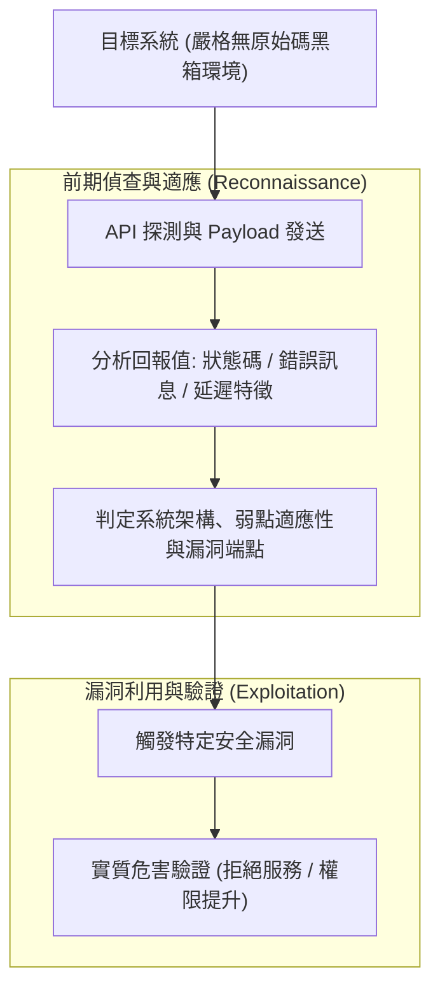

# 📋 黑箱 API 漏洞探測策略與利用鏈前期偵查研討 — 執行摘要

> **活動場次**：碩士學位論文 進度研討與口委質詢覆盤
> **錄音日期**：2026-10-08
> **發言講者**：侑宸 / 指導教授 / 審查委員/口委
> **對應完整逐字稿**：[`20261008-黑箱API漏洞探測策略與利用鏈前期偵查研討.full.md`](./20261008-黑箱API漏洞探測策略與利用鏈前期偵查研討.full.md)

---

## 📌 核心議題與會議提要

本場論文進度研討專門針對先前口試/進度報告時審查委員（楊老師）所提出的重大質詢進行深度覆盤。核心矛盾在於：原研究架構在黑箱評測中「直接跳躍至漏洞利用（Exploitation）階段」，缺乏對前期目標系統的偵查與適應過程，導致黑箱假設的合理性受到質疑。

研究生與指導教授在會中全面釐清了黑箱探測的資訊回報判定邏輯，明確區分無原始碼（No Source Code）前提下的回傳值分析方法，徹底消除白箱與黑箱界限混淆的缺陷。

---

## 🏛️ 黑箱 API 探測與漏洞利用鏈完整邏輯

---

## 🔑 關鍵重點整理 (Key Takeaways)

### 1. 釐清口委核心質疑：補齊前置偵查鏈與回報值判定
- 口委質疑之癥結在於未交代「黑箱攻擊者前期如何知道哪個系統有漏洞」。黑箱模型必須先透過自動化探測收集回傳特徵（Response 特徵、狀態碼），經由特徵判定符合條件後，方能進入利用模組。

### 2. 嚴格區分「功能不變性」與「安全不變性」：業務邏輯無通用 Crash Oracle
- 傳統模糊測試（Fuzzing）依賴系統崩潰（Crash / Sanitizer 報錯）作為 Oracle。但應用層邏輯漏洞不存在通用的對錯規則，API 即使回傳成功（HTTP 200）仍可能踩踏權限紅線。
- 必須在狀態機中嚴格區分「功能不變性（能讀到資料）」與「安全不變性（僅限授權身分讀到資料）」，使 AI Agent 能辨識缺乏安全檢查的邏輯捷徑。

### 3. 指導教授質詢：證明傳統自動化做不到、非靠 AI 不可的本質區別
- 教授嚴肅指出：「不能只列出一條條規則，然後說叫 AI 去檢查。如果寫規則就能做，為何需要 AI？我們能不能證明這是傳統自動化做不到的東西？」
- 必須突顯業務邏輯探索的「排列組合爆炸」與「狀態上下文依賴」：正常開發者只按常規路徑設計，只有 AI Agent 能模擬駭客逆向思維，在無窮狀態路徑中找出跳步繞過捷徑。

### 4. 失敗狀態（Fail）根因歸納與業務前提感知（Precondition Inference）
- 會議尾聲討論退款按鈕案例：傳統自動化 Fuzzer 點擊「退款」回傳 Fail 只會重試（Retry）或放棄。
- 教授指出：「Fail 有好幾個原因，可能是功能 Bug，也可能是業務前提未滿足。」
- AI Agent 必須具備「業務前提因果推論」能力：點擊退款若未生效，需自動回溯建立「前提訂單」，而非盲目重複點擊 100 次。

### 5. 文獻調研方法論：逐篇提煉 Research Gap 而非單向摘要
- 教授告誡文獻閱讀不可只列各篇做法，必須為每一篇經典文獻標註其獨特缺陷（Gap）與改進空間。
- 必須釐清為何非得用 GUI + API 雙軌結合：純 API 無法理解介面操作意圖，純 GUI 無法穿透網路層狀態，兩者結合方能補齊現有文獻缺口。

---

## 📊 應用層次邏輯（Application Logic）術語校準、PNS 組分工邊界與輕量化 Tracer 設計

| 研討核心議題 | 侑宸原提案設計與文獻調研 | 指導教授深度質詢與觀念修正 | 最終確立之論文架構與研究邊界 |
| :--- | :--- | :--- | :--- |
| **從「商業邏輯」擴展為「應用層次邏輯（Application Logic）」** | 原題目聚焦於電商優惠券、購物車金額竄改等「商業邏輯（Business Logic）」漏洞探測 | 指導教授指出：「百工百業包含農工商業，若只寫商業邏輯，工業控制或醫療系統怎麼辦？文字會限制思考格局！」 | 統一將研究範疇精確定義為**應用層次業務邏輯（Application-level Logic）**，涵蓋金融、物流、醫療與各類狀態機系統 |
| **與 PNS 組之前後端分工邊界** | 需向審查委員清楚說明本子計畫與 PNS 組在 API 檢測上的互補性 | PNS 組專注於後端 Server 側之傳統注入型漏洞（如 SQL Injection、XSS 模糊測試）與白箱修補；本研究則涵蓋 **App 前端 GUI 操作理解至後端 API 狀態驗證缺失** | 證明應用邏輯漏洞無法單靠隨機 Fuzzing 語法錯誤觸發，必須由 AI Agent 先理解正常業務流程，再蓄意跳步或反序操作以挖掘未驗證狀態 |
| **動態 Tracer 範圍定位 vs. 傳統控制流圖（CFG）** | 2026 前沿文獻結合輕量化 Tracer 觀察測試期間觸發之程式碼範圍，而非建構完整精確之全程式 CFG | 教授肯定此設計並回憶實驗室七、八年前曾嘗試細粒度分析但受限於工具成熟度；要求證明「這是傳統規則腳本或單純呼叫現成 AI 做不到的事」 | 以 GUI 事件搭配封包攔截（Wireshark / Proxy）建立業務狀態轉移圖，在不依賴原始碼 CFG 前提下實現高效率黑箱邏輯探測 |
| **前置偵查鏈缺失與回報值（Response）判定** | 簡報直接跳入漏洞利用階段（Exploit Execution），假設已掌握目標系統之脆弱點 | 審查委員楊老師與王老師質疑：「黑箱攻擊者前期如何知道哪個系統有漏洞？如何證明此路徑存在弱點？」 | 補齊前期偵查模組：依據外部觀測之 HTTP 回應特徵、狀態碼與業務副作用，建立「探測 ➔ 證據收集 ➔ 漏洞判定 ➔ 利用驗證」之完整閉環邏輯 |
| **傳統自動化 vs. AI Agent 本質區別質詢** | 整理規則檢查清單，交由 AI Agent 逐條比對 | 指導教授質疑：「這看起來整理很清楚，只是說，我們能不能證明這是傳統自動化做不到的東西？如果不說清楚，評審一定會砍我們的價值！」 | 論文前言與架構章節明確論證：應用邏輯狀態空間極其龐大，傳統靜態規則無法窮舉排列組合；AI Agent 核心價值在於動態生成假設並自主排程探索高價值路徑。 |
| **黑白箱假設矛盾與 QA 全生命週期過渡** | 前半段強調駭客無原始碼，後半段突然提到白箱修復與原始碼比對 | 指導教授告誡：「前面都說駭客什麼都不知道，後面突然又講白箱，聽了滿頭霧水！研究假設必須嚴格一致。」 | 明確定義「黑箱探測 ➔ 白箱修復」雙階段 QA 流程：外部黑箱探測作為觸發條件，確立漏洞真實存在後，方交由內部白箱團隊利用 Source Code 進行根因分析。 |
| **功能不變性 vs. 安全不變性（Invariance）** | 探討為何傳統 Fuzzing 無法檢測業務邏輯漏洞 | 透過社群貼文讀取與電子書搶購案例，解析業務邏輯「規則衝突而非崩潰」之特性 | 建立雙軌驗證模型：確保功能正常（可讀取結果）的同時，強制驗證安全紅線（未經身分授權不得生效）。 |

