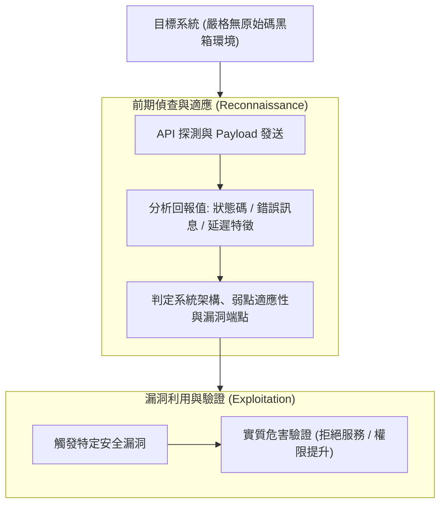

# 📋 黑箱 API 漏洞探測策略與利用鏈前期偵查研討 — 執行摘要

> **活動場次**：碩士學位論文 進度研討與口委質詢覆盤
> **錄音日期**：2026-10-08
> **發言講者**：侑宸 / 指導教授 / 審查委員/口委
> **對應完整逐字稿**：[`20261008-黑箱API漏洞探測策略與利用鏈前期偵查研討.full.md`](./20261008-黑箱API漏洞探測策略與利用鏈前期偵查研討.full.md)

---

## 📌 核心議題與會議提要

本場論文進度研討專門針對先前口試/進度報告時審查委員（楊老師）所提出的重大質詢進行深度覆盤。核心矛盾在於：原研究架構在黑箱評測中「直接跳躍至漏洞利用（Exploitation）階段」，缺乏對前期目標系統的偵查與適應過程，導致黑箱假設的合理性受到質疑。

研究生與指導教授在會中全面釐清了黑箱探測的資訊回報判定邏輯，明確區分無原始碼（No Source Code）前提下的回傳值分析方法，徹底消除白箱與黑箱界限混淆的缺陷。

---

## 🏛️ 黑箱 API 探測與漏洞利用鏈完整邏輯

---

## 🔑 關鍵重點整理 (Key Takeaways)

### 1. 釐清口委核心質疑：補齊前置偵查鏈
- 口委質疑之癥結在於未交代「如何知道哪個系統有漏洞」。黑箱模型必須先透過自動化探測收集回傳特徵，經由特徵判定符合條件後，方能進入利用模組。

### 2. 嚴格杜絕假設衝突
- 論文前半部強調「零原始碼黑箱」，後半部不可突兀出現依賴原始碼（Source Code）的假設。必須始終維持架構的一致性，透過外部觀測量（API Response）完成證明。

### 3. 修訂論文章節脈絡
- 重新調整論文第四章實作流程圖，明確將章節拆分為「探測與目標識別模組」與「漏洞驗證與利用模組」，使整套防禦與評測框架邏輯閉環。

---

## 📊 應用層次邏輯（Application Logic）術語校準、PNS 組分工邊界與輕量化 Tracer 設計

| 研討核心議題 | 侑宸原提案設計與文獻調研 | 指導教授深度質詢與觀念修正 | 最終確立之論文架構與研究邊界 |
| :--- | :--- | :--- | :--- |
| **從「商業邏輯」擴展為「應用層次邏輯（Application Logic）」** | 原題目聚焦於電商優惠券、購物車金額竄改等「商業邏輯（Business Logic）」漏洞探測 | 指導教授指出：「百工百業包含農工商業，若只寫商業邏輯，工業控制或醫療系統怎麼辦？文字會限制思考格局！」 | 統一將研究範疇精確定義為**應用層次業務邏輯（Application-level Logic）**，涵蓋金融、物流、醫療與各類狀態機系統 |
| **與 PNS 組之前後端分工邊界** | 需向審查委員清楚說明本子計畫與 PNS 組在 API 檢測上的互補性 | PNS 組專注於後端 Server 側之傳統注入型漏洞（如 SQL Injection、XSS 模糊測試）與白箱修補；本研究則涵蓋 **App 前端 GUI 操作理解至後端 API 狀態驗證缺失** | 證明應用邏輯漏洞無法單靠隨機 Fuzzing 語法錯誤觸發，必須由 AI Agent 先理解正常業務流程，再蓄意跳步或反序操作以挖掘未驗證狀態 |
| **動態 Tracer 範圍定位 vs. 傳統控制流圖（CFG）** | 2026 前沿文獻結合輕量化 Tracer 觀察測試期間觸發之程式碼範圍，而非建構完整精確之全程式 CFG | 教授肯定此設計並回憶實驗室七、八年前曾嘗試細粒度分析但受限於工具成熟度；要求證明「這是傳統規則腳本或單純呼叫現成 AI 做不到的事」 | 以 GUI 事件搭配封包攔截（Wireshark / Proxy）建立業務狀態轉移圖，在不依賴原始碼 CFG 前提下實現高效率黑箱邏輯探測 |

