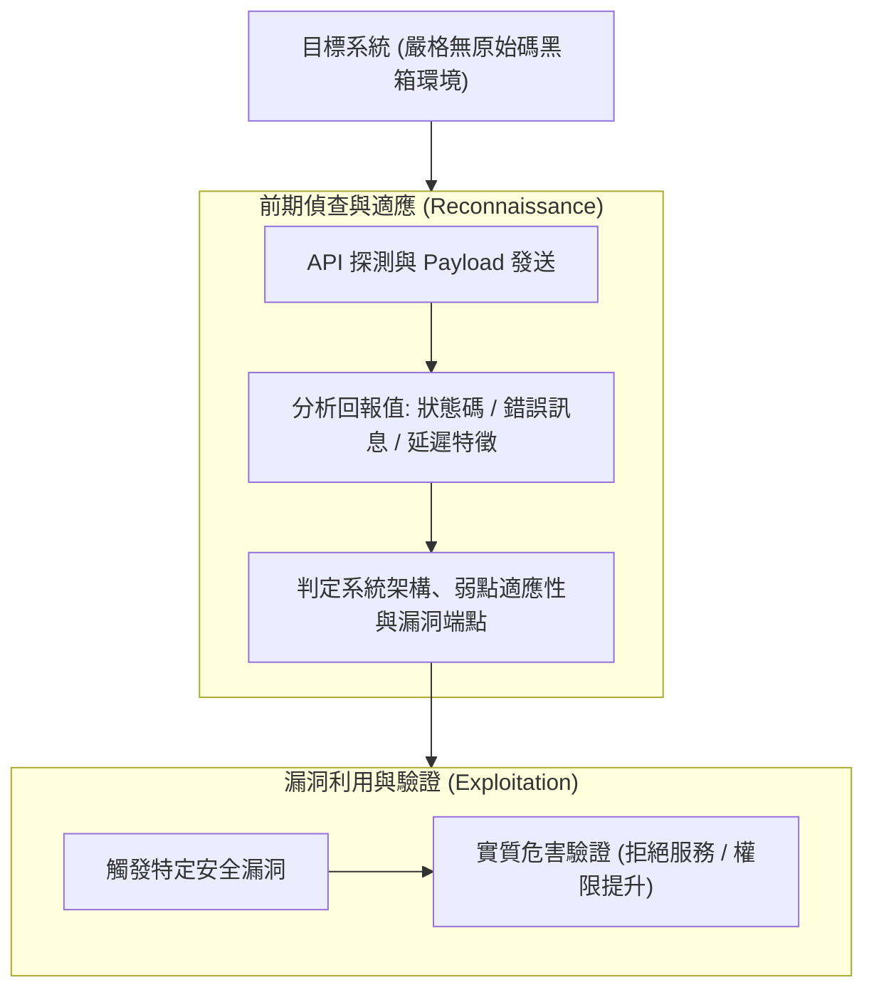

# 📋 黑箱 API 漏洞探測策略與利用鏈前期偵查研討 — 執行摘要

- **活動場次**：碩士學位論文 進度研討與口委質詢覆盤
- **錄音日期**：2026-10-08
- **發言講者**：侑宸 / 指導教授 / 審查委員/口委
- **對應完整逐字稿**：[`20261008-黑箱API漏洞探測策略與利用鏈前期偵查研討.full.md`](./20261008-黑箱API漏洞探測策略與利用鏈前期偵查研討.full.md)

---

## 📌 核心議題與會議提要

本場論文進度研討專門針對先前口試/進度報告時審查委員（楊老師）所提出的重大質詢進行深度覆盤。核心矛盾在於：原研究架構在黑箱評測中「直接跳躍至漏洞利用（Exploitation）階段」，缺乏對前期目標系統的偵查與適應過程，導致黑箱假設的合理性受到質疑。

研究生與指導教授在會中全面釐清了黑箱探測的資訊回報判定邏輯，明確區分無原始碼（No Source Code）前提下的回傳值分析方法，徹底消除白箱與黑箱界限混淆的缺陷。

---

## 🏛️ 黑箱 API 探測與漏洞利用鏈完整邏輯

---

## 🔑 關鍵重點整理 (Key Takeaways)

### 1. 釐清口委核心質疑：補齊前置偵查鏈
- 口委質疑之癥結在於未交代「如何知道哪個系統有漏洞」。黑箱模型必須先透過自動化探測收集回傳特徵，經由特徵判定符合條件後，方能進入利用模組。

### 2. 嚴格杜絕假設衝突
- 論文前半部強調「零原始碼黑箱」，後半部不可突兀出現依賴原始碼（Source Code）的假設。必須始終維持架構的一致性，透過外部觀測量（API Response）完成證明。

### 3. 修訂論文章節脈絡
- 重新調整論文第四章實作流程圖，明確將章節拆分為「探測與目標識別模組」與「漏洞驗證與利用模組」，使整套防禦與評測框架邏輯閉環。
