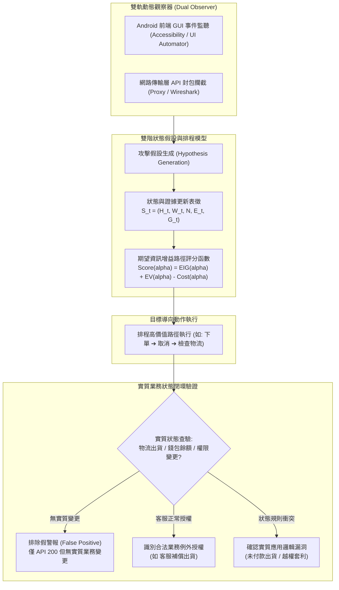

# 📋 Android 黑箱應用邏輯漏洞自主探索與雙階狀態假設驗證 — 執行摘要

> **活動場次**：網路與系統實驗室 碩士學位論文核心架構進度研討 (場次 02)  
> **錄音日期**：2026-10-12  
> **報告講者**：侑宸（Youchen）  
> **研討講者**：指導教授、同儕研究生（義軍等）  
> **對應完整逐字稿**：[`20261012-02-Android黑箱商業邏輯漏洞自主探索與雙階狀態假設驗證.full.md`](./20261012-02-Android黑箱商業邏輯漏洞自主探索與雙階狀態假設驗證.full.md)

---

## 📌 核心議題與論文進度提要

本場次為**侑宸（Youchen）碩士學位論文核心架構進度報告**。針對現有黑箱模糊測試（Black-box Fuzzing）在行動應用程式邏輯漏洞檢測中普遍存在的盲目隨機性、步數冗餘以及高誤報率問題，侑宸提出一套模擬人類資安滲透專家思維之「自主探索 Agent 框架」。該架構立足於**嚴格外部黑箱假設**（無原始碼存取權限），結合 Android 前端 GUI 介面事件監聽與網路傳輸層 API 封包攔截，建立雙階狀態推理與路徑選擇機制。

### 本次報告與研討三大關鍵進展：
1. **破除靜默失敗（HTTP 200 假陽性）**：傳統自動化 Fuzzer 常誤將「API 回傳 200」判定為操作成功；本研究指出業務邏輯漏洞本質為「規則衝突而非系統崩潰」，必須透過追蹤後續物流、金流或資料持久化狀態之實質變更（Side Effects），達成業務狀態的二次閉環驗證。
2. **形式化狀態空間與排程模型**：提出狀態空間表徵 $S_t = (H_t, W_t, N, E_t, G_t)$ 與基於期望資訊增益（Expected Information Gain, EIG）之候選路徑排程公式 $Score(\alpha) = EIG(\alpha) + EV(\alpha) - Cost(\alpha)$，引導 Agent 在算力與 Token 預算限制下優先執行最具驗證價值之操作鏈。
3. **指導教授深度質詢與架構收斂**：針對圖表簡化導致的語意模糊、LLM 產出術語（如「增量」）缺乏數學定義、以及優惠券多維測試矩陣（$H_1, H_2, H_3$）的排列邏輯，指導教授帶領全體與會者進行了深入的實戰梳理，確立了「矩陣語境化」、「案例二維分類映射」與「消融實驗設計」等重要修訂方向。

---

## 🏛️ 侑宸黑箱應用邏輯漏洞自主探索與推理架構

---

## 🔑 關鍵重點整理 (Key Takeaways)

### 1. 破除 API 假陽性：端到端業務狀態二次閉環
- 商業與應用邏輯漏洞的本質不是系統崩潰（Crash），而是業務規則的不符。
- 單純監測 HTTP 狀態碼回傳 200 經常是假陽性（例如使用者取消訂單後，直接送出出貨 API，伺服器可能基於預設應答回傳 200，但資料庫中物流根本未成立）。
- Agent 必須具備「多角色切換與關聯狀態查驗」能力，主動交叉驗證金流扣款記錄、物流追蹤 API 或客服後台視角，確保漏洞的確認建立在實質業務副作用之上。

### 2. 狀態空間表徵 $S_t$ 與 EIG 候選路徑排程模型
- **狀態與證據表徵 $S_t = (H_t, W_t, N, E_t, G_t)$**：
  - $H_t$：當前對後端業務邏輯規則之假設集。
  - $W_t$：已探索之路徑與攻擊進度。
  - $N$：系統固有之安全約束（如 A 帳號不可讀取 B 帳號資料），需獨立證據支撐。
  - $E_t$：當前已獲取之正向與反向觀測證據。
  - $G_t$：為判定漏洞仍缺少的關鍵證據缺口（Information Gap）。
- **路徑評分排序函數 $Score(\alpha) = EIG(\alpha) + EV(\alpha) - Cost(\alpha)$**：
  - 於當前畫面多個互動元素（按鈕、表單）中，衡量候選動作 $\alpha$ 能否帶來最高期望資訊增益（$EIG$）與驗證價值（$EV$），同時扣除 Token 與執行成本（$Cost$），避免無序漫遊。

### 3. 優惠券測試矩陣（$H_1, H_2, H_3 \times T_1, T_2, T_3, T_4$）語境化解析
- 會中教授指出原簡報表格過於緊湊抽象，經同儕研討後明確其排他性維度：
  - **前提**：帳號 A 已在訂單 1 使用過目標優惠券。
  - **假設維度**：
    - $H_1$（單帳號限制）：每隻帳號終身限用一次。
    - $H_2$（單訂單限制）：每筆訂單可獨立使用一次（帳號可於新訂單重複使用）。
    - $H_3$（通用促銷限制）：限定特定商品或全系統單次兌換。
  - **測試維度**：
    - $T_1$：帳號 A 於新訂單（訂單 2）使用同張券 ➔ $H_1$ 應拒絕，$H_2$ 應接受。
    - $T_2$：切換為帳號 B 於新訂單使用該券 ➔ 若 $T_1$ 拒絕但 $T_2$ 接受，則證實 $H_1$ 成立。
- **指示**：表格必須補足文字背景故事與使用者場景，避免口試委員困惑。

### 4. 權限探測原則：自最高權限帳號向下執行差集比對
- 探測需依賴真實滲透測試情境之「進入點假設」，即至少具備一組管理者帳密與一組一般使用者帳密。
- 透過最高權限帳號操作爬梳完整功能與 API 端點清單，再以低權限身分嘗試未授權存取，並經由雙軌觀察器驗證後端是否落實越權防護。

---

## 📊 研討核心爭點、指導教授指正與論文修訂方針對照表

| 研討核心爭點 | 侑宸原簡報設計與說明 | 指導教授深度質詢與核心點評 | 論文修訂方針與具體行動清單 |
| :--- | :--- | :--- | :--- |
| **術語嚴謹性與 AI 空泛詞彙** | 簡報中使用「增量」一詞描述本架構相較於過往研究之性能優勢。 | **「什麼叫增量？英文是什麼？」** 嚴厲指出學術論文不可未加定義即採用 LLM 隨機產生的空泛詞彙，口試時必定受到委員強烈質疑。 | 全面剔除「增量」等未嚴格定義之字眼，改用精確的學術指標：**「步數精簡度（Step Efficiency）」**、**「單位時間漏洞發現率」** 或 **「探索覆蓋增益」**。 |
| **優惠券測試矩陣可讀性** | 簡報第 26 頁之 $H_1, H_2, H_3$ 表格過於簡略，僅列符號與對應結果。 | **「你在很小的表裡要表達很多意思，老師光看表就不懂！」** 要求交代橫看還是直看、A 帳號代表什麼、新訂單是訂單二還是原訂單。 | 重繪第 26 頁圖表，在表格旁加入完整的使用者情境（Case 1/2/3），標明前提（已在訂單 1 履約）、操作角色（Account A/B）與訂單序號。 |
| **分類模型之完備性與案例映射** | 整理了 6 種缺乏證據之情況與常見漏洞案例。 | **「第 24 頁的模型如果夠完整，所有案例都應該能在第 26 頁的二維空間中找到對應位置！」** | 建立統一架構對照表，將「取消訂單出貨（副作用不明）」、「優惠券套利（安全約束不明）」與「管理員越權」等案例，全數映射至分類矩陣中。 |
| **公式與代號取名之數學習慣** | 使用 $C_1, C_2$ 代表候選假設與排程公式。 | **「取個 C 我們總是想不透代表什麼？C 在數學上常用於集合（Collection）或覆蓋（Cover）。」** | 將公式符號標準化為資安與強化學習領域通用的代號：狀態空間使用 $S_t$，排程評分使用 $Score(\alpha)$ 或 $Utility(\alpha)$，提升論文專業度。 |
| **基準對標資料集與消融實驗設計** | 提出在固定預算（如 1 小時或 100 元 API 費用）下與現有 Agent 比對發現漏洞數量。 | 肯定研究定位，指示需研讀以人工標註為基準之經典文獻（如 16 位學生標註 47 個真實漏洞案例之研究），並透過消融實驗驗證各模組貢獻。 | 1. 引入開源 Vulnerable Apps 與真實案例資料集作為 Benchmark。 2. 設計消融實驗（Ablation Study）：分別拔除 $S_t$ 與 $Score(\alpha)$，量化證明數學排程機制對降低步數之實質貢獻。 |
