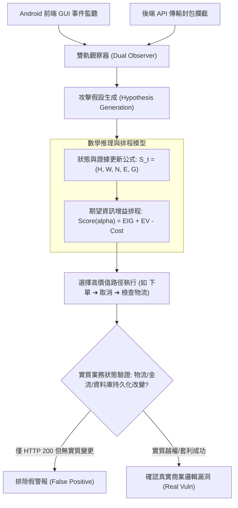

# 📋 Android 黑箱商業邏輯漏洞自主探索與雙階狀態假設驗證 — 執行摘要

- **活動場次**：網路與系統實驗室 碩士學位論文核心架構進度研討 (場次 02)
- **錄音日期**：2026-10-12
- **發言講者**：侑宸 / 指導教授 / 同儕研究生
- **對應完整逐字稿**：[`20261012-02-Android黑箱商業邏輯漏洞自主探索與雙階狀態假設驗證.full.md`](./20261012-02-Android黑箱商業邏輯漏洞自主探索與雙階狀態假設驗證.full.md)

---

## 📌 核心議題與論文進度提要

本場次為**侑宸（Youchen）碩士學位論文核心進度報告**。侑宸針對現有黑箱模糊測試（Black-box Fuzzing）在移動應用程式商業邏輯漏洞檢測中的盲目性與高误報率，提出一套模擬人類滲透測試專家思維的自主探索 Agent 框架。系統結合 Android 介面 GUI 事件監聽與網路層 API 封包攔截，建立雙階狀態推理機制。

報告重點在於破除傳統研究「單純敲 API 回傳 HTTP 200 即判定漏洞」的嚴重假警報缺陷（例如取消訂單後 API 仍回傳成功，但後端並未實際觸發物流出貨）。侑宸建立了狀態假設更新公式 $S_t$ 與基於期望資訊增益（EIG）的候選路徑評分函數，約束 Agent 在預算限制下優先執行最具驗證價值之操作。

會議中指導教授針對圖表簡化導致的理解障礙、AI 產出術語（如「增量」）的嚴謹度、以及 $H_1, H_2, H_3$ 優惠券測試矩陣的排列組合邏輯，進行了長達一小時的深度實戰質詢，同儕亦加入協助釐清矩陣語意。

---

## 🏛️ 侑宸黑箱商業邏輯漏洞自主探索與推理架構

---

## 🔑 關鍵重點整理 (Key Takeaways)

### 1. 破除 API 假警報：業務狀態二次閉環
- 商業邏輯漏洞的本質不是崩潰（Crash），而是規則衝突。不能依賴 HTTP 回傳碼，必須引導 Agent 追查金流、物流或多角色（消費者 vs 客服）的權限變更記錄。

### 2. 狀態空間與 EIG 候選路徑排程
- 提出兩套公式：第一套公式定義當前輪次已知資訊、後端行為假設與缺少之獨立證據；第二套公式以資訊增益減去 Token 與執行成本，決定畫面多個按鈕中哪一個最值得優先測試。

### 3. 指導教授現場質詢與論文修訂方針
- **嚴禁使用未定義的模糊詞彙**：教授嚴厲質疑「增量」一詞出處，告誡學術論文不可未加定義即採用 LLM 隨機產生的空泛字眼，應改用精確的「步數精簡度（Step Efficiency）」或「探索覆蓋增益」。
- **圖表必須自帶完整語境**：針對 $H_1$（單帳號單次）、$H_2$（單訂單單次）、$H_3$（全系統記名/不記名）優惠券矩陣，教授指出原始表格過於精簡導致橫看直看皆令人困惑，指示必須在表格旁明確補足使用者情境（Case 1/2/3）與新舊訂單定義。
- **黑箱假設的一致性**：提醒研究從始至終不可假設擁有 Source Code，所有論證皆需立足於外部黑箱觀測。
