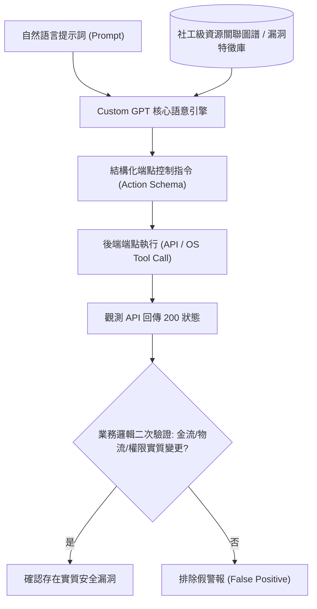

# 📋 Custom GPT 提示詞轉端控制與社工資源關聯標記研究 — 執行摘要

- **活動場次**：碩士學位論文 核心架構突破與研究進度研討
- **錄音日期**：2026-10-12
- **發言講者**：論文研究生 / 指導教授 / 研究團隊同儕
- **對應完整逐字稿**：[`20261012-Custom-GPT提示詞轉端控制與社工資源關聯標記研究.full.md`](./20261012-Custom-GPT提示詞轉端控制與社工資源關聯標記研究.full.md)

---

## 📌 核心議題與會議提要

本場長達 132 分鐘的深度論文研討，記錄了碩士研究從自然語言提示詞邁向系統端控制的核心突破。報告人詳細闡述了 Custom GPT 的緣由與架構設計，探討如何將大語言模型的純文字對話輸出，轉化為能夠驅動後端 API 與作業系統端點操作（Endpoint Control）的確定性控制信號。

同時，研討探討了在安全審計中結合「社工級資源標記（Social Engineering Resource Tagging）」與威脅情報圖譜的實踐，破除「僅憑 API 回傳 HTTP 200 即判定漏洞成立」的粗糙評估缺陷，提出透過真實業務金流與物流狀態進行二次閉環驗證的嚴密方案。

---

## 🏛️ Custom GPT 提示詞轉端控制與雙重驗證架構

---

## 🔑 關鍵重點整理 (Key Takeaways)

### 1. 提示詞工程進化為端點控制
- Custom GPT 不只是客製化聊天介面，其核心價值在於透過 Function Calling 與 Action 協議，將模糊的語意意圖轉換為具有確定性、原子性的端點執行指令。

### 2. 破除 API 假警報：業務狀態二次驗證
- 安全檢測不能只看「API 回傳 200 OK」。報告人強調必須引導代理人深入檢查後端金流、物流或帳號權限的實際持久化狀態，確認實質危害已經發生，杜絕誤報。

### 3. 社工級標記與論文定位
- 將社工情資與資源關係網引入攻擊路徑分析，精準標定受害者特徵與弱點位置。教授高度認可右圖架構圖的改進，並指導其在整篇論文創新點中的精準學術定位。
